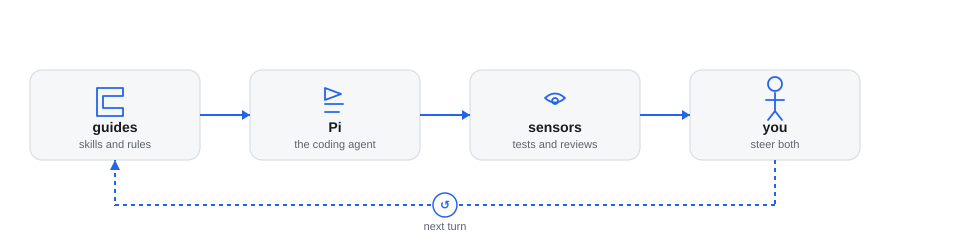
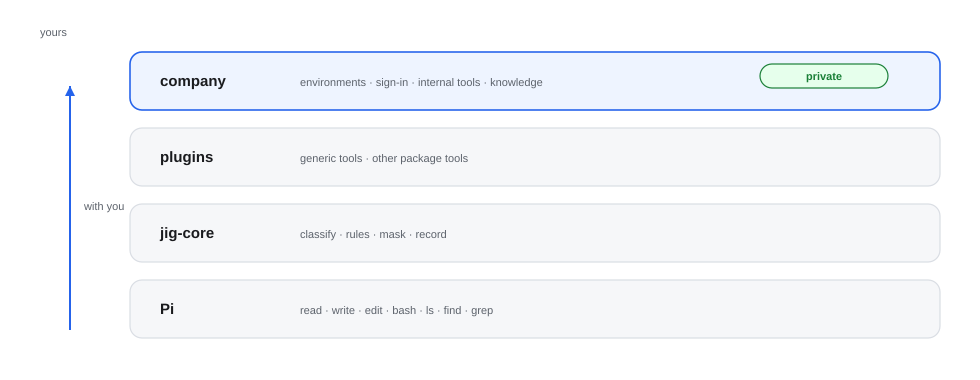

# Jig

[](https://github.com/Dev-Mriganka/jig/actions/workflows/ci.yml)

Jig is a set of plugins for the [Pi](https://pi.dev) coding agent. They decide
what the agent may do, ask you when it matters, keep secrets out of its reach,
and record what happened so you can see it later.

**Status:** fifteen of the fifteen plugins are built. Each plugin's README is the
specification that its code follows. New to a word? See the [glossary](docs/glossary.md).

## What works today

In short:
- **Safety:** [`jig-core`](plugins/jig-core/README.md) governs every tool call.
  It applies rules per environment, asks you when a rule says so, keeps secrets
  out of the model's reach and masks production results. Pi's own file tools
  cannot read your credential folders or change Pi's settings.
- **Sign-in:** Jig never signs in. A credential comes from where you already keep
  it: an environment variable, a password manager, a command such as
  `gh auth token`, or a company's sign-in service. `jig-core` attaches it to the
  request, and no plugin sees its value.
- **Code:** `jig-git` (git, GitHub and GitLab pull requests, releases), `jig-review` (a code
  review in the browser, approved with a passkey) and `jig-ops` (CI, deploy and
  what runs, from one service catalog).
- **Other systems:** `jig-jira`, `jig-logs` (Elasticsearch, OpenSearch, Loki),
  `jig-api` (your saved API requests, run by name) and `jig-mongo` (MongoDB, with
  allow and deny lists).
- **Seeing and remembering:** `jig-lens` shows cost, failures and the time spent
  waiting for you. `jig-memory` keeps a folder of notes and evidence per ticket, writes a card when
  a ticket closes, and brings related earlier tickets back when a new one starts.
- **Taking work through stages:** `jig-workflow` runs a ticket through a workflow you define. It records
  evidence itself (tests run in the sandbox at the exact commit, a plan you approved, a review, a pull
  request) and holds `git push`, `edit` and `write` until the condition for them holds.
- **How Pi looks:** `jig-theme` gives six palettes, a one-line footer and your
  own colours. `jig-session` publishes each session's state as a file other programs read, such as the
  [Herdr app](#the-herdr-app) files.
- **Checked on every push:** the type check, Biome, over 5,000 tests, the
  review page's build and every link in these docs run on GitHub Actions. A
  second job runs the plugins against real Elasticsearch, OpenSearch, Loki,
  MongoDB, Kubernetes, GitHub, an SSH server and an OAuth server
  ([Integration tests](docs/integration-tests.md)).

Also built: [`jig-sandbox`](plugins/jig-sandbox/README.md), which runs the
agent's `bash` in an operating-system sandbox, with background tasks and a network that
can be filtered or asked about. And [`jig-agents`](plugins/jig-agents/README.md), which hands work to child
agents that Jig's rules still govern: their questions come to your screen, their turns, time and cost are
limited, and a role can only narrow what its child may do.

## Install

Jig needs Pi 1.4 or later and Node.js 22.19 or later. It is tested with:

| Pi | Node | Checked |
|---|---|---|
| 1.5.0 | 24, 26 | 2026-11-02 |

A weekly run tries the newest Pi too, so a release that breaks Jig is seen early. [Compatibility](docs/compatibility.md)
says what that covers and which names Jig keeps stable for company plugins.

```bash
pi install git:github.com/Dev-Mriganka/jig
```

Then start Pi and run `/jig`: it shows the rules in force and anything that
needs fixing. Each plugin's README says what it needs in `~/.pi/agent/jig.json`
and which programs it uses, such as `git`, `gh` and `glab` for `jig-git`.

To load only some plugins, filter the package in Pi's settings. Name each plugin by
its entry file, `plugins/<name>/index.ts` (a filter that names `src/index.ts`
matches nothing). Keep `jig-core` first in the list, because every other plugin
needs it:

```json
{
  "packages": [
    {
      "source": "git:github.com/Dev-Mriganka/jig",
      "extensions": [
        "plugins/jig-core/index.ts",
        "plugins/jig-sandbox/index.ts",
        "plugins/jig-git/index.ts"
      ]
    }
  ]
}
```

## Starting Pi

The launcher is optional: [`bin/pi`](bin/pi) starts Pi inside its own tmux, so closing the terminal window only detaches it, and the
next `pi` in that folder offers to reattach. Jig works without it; `pi install` is all Jig needs.

It is a bash script, not a plugin, so Pi never loads it. Tested on Linux and WSL2. It needs bash 4.4 or later (macOS ships 3.2: install
a newer one).

**It never signs in and never touches the network,** and it sets none of your settings: Pi's own defaults apply. To set your own,
write a shim at `~/.local/bin/pi` that exports them and runs the launcher. The launcher skips a shim when it looks for the real Pi:

```bash
#!/usr/bin/env bash
export PI_CODING_AGENT_DIR="$HOME/.pi/work-agent"
export BROWSER=/usr/local/bin/my-browser
exec /path/to/jig/bin/pi "$@"
```

| Flag | Variable | Effect |
|---|---|---|
| `--no-tmux` | `JIG_NO_TMUX=1` | Stay out of tmux: Pi runs in this terminal |
| `--new` | `JIG_NEW=1` | Never offer to reattach; start a new session |

The launcher removes these flags before Pi sees the arguments. What it reads besides them:

| Variable | Meaning |
|---|---|
| `PI_BIN` | The Pi executable. Default: the first `pi` on the PATH that is Pi's own npm install, not a shim |
| `HC_TERMINAL_ID` | Set by herdr in its terminals. There the launcher skips tmux, because herdr keeps the terminal alive |
| `JIG_TMUX` | `1` uses tmux in a herdr terminal too |
| `WSL_INTEROP` | On WSL, set to the distro's own socket when it is missing (a shell started over SSH, such as a herdr terminal) or when the one in use does not answer |

The launcher exports one variable, `JIG_HOME`, the folder `bin/` is in, which `bin/tmux.conf` reads. When no Pi is found it exits 127.

A run that is not interactive (no terminal, a print or help flag, or a subcommand such as `install`, `list` or `config`) starts Pi
directly. Otherwise:
- **Interop repair (WSL).** If the Windows interop socket does not answer a 2 second probe, the launcher switches to the distro's own, so
  a browser or the clipboard does not hang. A shell started over SSH has no socket at all; it gets the distro's, with no probe.
- **Copy on select.** Releasing a mouse selection in Jig's tmux copies it with [`bin/clipboard-copy`](bin/clipboard-copy): Windows'
  `clip.exe` on WSL (found by its full path, since an SSH shell has no Windows folders on its PATH), else `wl-copy`, `xclip` or
  `pbcopy`. When none works, tmux shows "Not copied" and why, instead of looking copied.
- **tmux.** It starts its own server (`tmux -L jig -f bin/tmux.conf`), so your own tmux is never changed. The session is named
  `pi-<folder>-<pid>` and runs the launcher again inside. When tmux returns and the session is still there, it says how to come back.
- **Reattach.** Before it starts a session, `pi` and `pi -c` look for detached sessions started in this folder. One is reattached with
  a one-line notice; several give a numbered menu, and Enter or `n` starts a new one.
- **The environment.** Pi inside tmux sees this terminal's environment, as if started here. Every exported variable is passed on except
  those that describe the terminal or the shell (`TERM`, `TMUX`, `TERM_PROGRAM`, `SHLVL`, `PWD` and a few more; the list is in `bin/pi`).
- **What an earlier terminal left behind.** A variable the tmux server holds from the terminal that started it, and this one does not
  set, is removed from the session. Values travel through tmux's socket, never on a command line.

Two things a launcher is often asked to do are settings of `jig.json` instead, and run inside Pi however it was started. They are
built on another branch and are not part of this version:
- **Checks before the first prompt,** such as reaching a VPN-only host: `startChecks`, run by `jig-core`.
- **Unlocking a password store at start:** `secrets.pass.unlockAtStart`, run by `jig-core`.

Why the launcher is this small: [Decisions](docs/decisions.md#2026-11-02-an-optional-launcher-with-nothing-a-company-decides).

## Where Jig sits


*Three harnesses, one inside the other, in [Birgitta Böckeler's](https://martinfowler.com/articles/harness-engineering.html) terms: the model is what gets harnessed, Pi's builders made the inner harness, and Jig is yours. A team harness would be the next ring if a team adopts Jig, and shared organizational memory would live there.*

## How Jig steers the agent



*Guides go forward into Pi before it acts, sensors feed back after it acts, and you steer by changing both. A star marks a model deciding, a dot a program, a figure a person, and a dashed outline something planned for later.*

## The plugins

| Plugin | Status | What it gives you |
|---|---|---|
| [`jig-core`](plugins/jig-core/README.md) | built | The tool manager: rules per environment, approvals, secrets, masking, watches, records |
| [`jig-sandbox`](plugins/jig-sandbox/README.md) | built | The agent's `bash` in an operating-system sandbox: credentials hidden, start-up files locked, everything else as outside; background tasks; a filtered network |
| [`jig-git`](plugins/jig-git/README.md) | built | Local git, GitHub pull requests and GitLab merge requests with reviews, tags and releases |
| [`jig-lens`](plugins/jig-lens/README.md) | built | Cost, tool failures and time spent waiting for you, inside Pi and on a local page; Grafana optional |
| [`jig-workflow`](plugins/jig-workflow/README.md) | built | Named workflows you define: stages, exit conditions checked against evidence, holds, test runs in the sandbox |
| [`jig-memory`](plugins/jig-memory/README.md) | built | Ticket folders, notes and evidence; a card per closed ticket, and recall of related tickets |
| [`jig-mongo`](plugins/jig-mongo/README.md) | built | MongoDB: explore, query, aggregate and write, with allow and deny lists |
| [`jig-jira`](plugins/jig-jira/README.md) | built | Jira issues: read, comment, transition, update, with rendered previews |
| [`jig-logs`](plugins/jig-logs/README.md) | built | Log search over Elasticsearch, OpenSearch or Grafana Loki |
| [`jig-api`](plugins/jig-api/README.md) | built | Your saved API requests (Postman, Bruno, `.http`, OpenAPI), run by name |
| [`jig-ops`](plugins/jig-ops/README.md) | built | CI, deploy and runtime from one service catalog; watches CI until it ends |
| [`jig-review`](plugins/jig-review/README.md) | built | Code review in the browser, answered round by round, approved with a passkey |
| [`jig-theme`](plugins/jig-theme/README.md) | built | Six palettes as Pi themes, your own, a one-line footer, the answer colour |
| [`jig-session`](plugins/jig-session/README.md) | built | The live session's state as a status file other programs read: terminal, model, context, ticket, stage, changed files, recent calls |
| [`jig-agents`](plugins/jig-agents/README.md) | built | Child agents that Jig's rules still govern: their questions come to your screen, with limits on turns, time and cost, and roles that only narrow |

Every plugin needs `jig-core`; otherwise they work on their own.



*What lives where. Everything below the company plugin goes with you to any job; the company plugin stays private and only configures the generic plugins or adds backends and knowledge to them.*

**Company parts never go into this repository.** A company's environment
names, sign-in service, internal tools and backends live in a private company
plugin, so these generic plugins can go with you to any job. To write one, read
[Writing a company plugin](docs/company-plugin.md); [`examples/jig-acme`](examples/jig-acme/README.md)
is a complete, tested example for a made-up company.

[Plugins](docs/plugins.md) shows, for every tool, what is generic and what the
company plugin supplies, and the order of building.

## The Herdr app

[`herdr/`](herdr/README.md) is not a plugin: it is a layout and mods for the [Herdr](https://herdr.dev) desktop app, copied
into the app's folder by a script. Its Work and Context panels show the Pi session in focus from `jig-session`'s file (ticket,
stages, pull requests, changed files, recent calls, what fills the context), beside the changes, history, pull requests and
worktrees of every repository, and the window follows the Jig palette. [How it works](herdr/docs/how-it-works.md).

## Read in this order

**New here?** [Your first hour with Jig](docs/first-hour.md) takes you from install to your first approval,
the sandbox check and `/lens`, in plain words. Then:

1. [Architecture](docs/architecture.md): how the tool manager sits over every
   tool, what it can and cannot control, and where each plugin fits.
2. [Permissions](docs/permissions.md): environments, rules per tool, and the
   floor that configuration cannot lower.
3. [Approvals](docs/approvals.md): how and where you are asked.
4. [Secrets](docs/secrets.md): where passwords and tokens come from, where `pass`
   looks, and how to use the store you already have.
5. [Plugins](docs/plugins.md): every tool and the plugin it belongs to.
6. [Writing a company plugin](docs/company-plugin.md): what a company adds, the
   seams in order, how your `jig.json` layers over its defaults, and the tested
   example in `examples/jig-acme`.
7. [Decisions](docs/decisions.md): what was decided, what was rejected, and why.
8. [Compatibility](docs/compatibility.md): what Jig is tested with, which names are public, and what counts as
   breaking.
9. [Glossary](docs/glossary.md): the terms these documents use.
10. [Writing the docs](docs/writing.md): how these pages are written, if you
    add to them.
11. **The code, with a map.** The big plugins each have a code map, with every file, who calls it and one call
    traced through them: [`jig-core`](plugins/jig-core/docs/code-map.md), [`jig-api`](plugins/jig-api/docs/code-map.md),
    [`jig-ops`](plugins/jig-ops/docs/code-map.md), [`jig-sandbox`](plugins/jig-sandbox/docs/code-map.md),
    [`jig-agents`](plugins/jig-agents/docs/code-map.md) and [`jig-workflow`](plugins/jig-workflow/docs/code-map.md).

## Relationship to the existing harness

Jig is built clean, beside the harness the author uses every day today:
- **It does not modify that harness.**
- **It ports what works.**
- **That harness keeps running** until each Jig plugin can replace its part.
