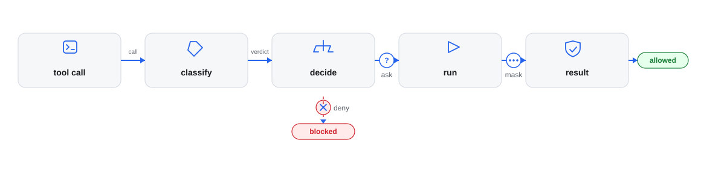
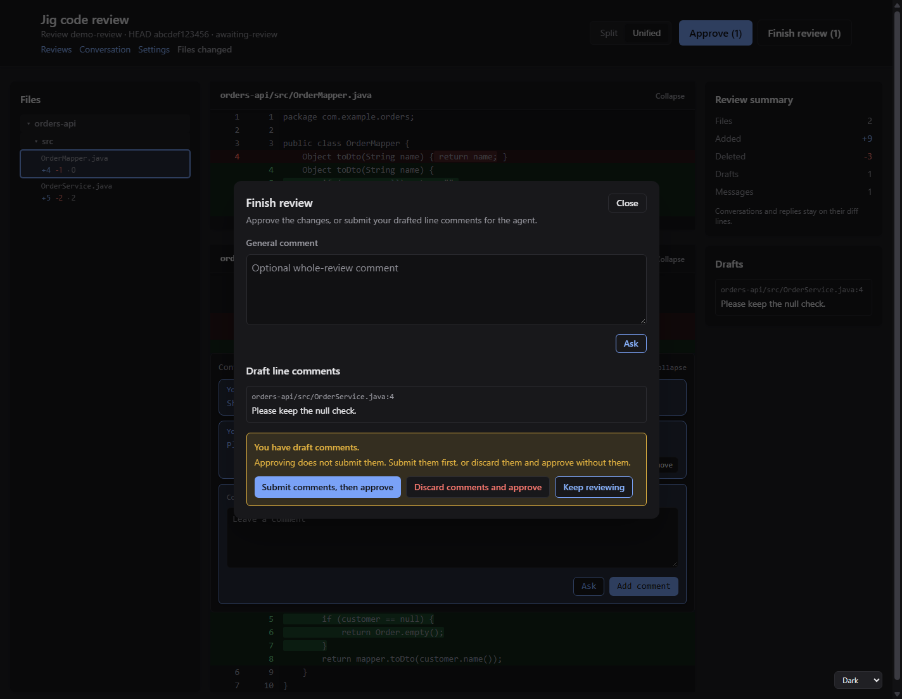

# Jig

[](https://github.com/ClawdBuilder/jig/actions/workflows/ci.yml)
[](LICENSE)

**Rules, approvals and a record for the [Pi](https://pi.dev) coding agent.**

Jig decides what the agent may do. It asks you before a write, keeps credentials and personal data away from the model,
and records every call it allows. It never signs in: the tool that owns a login does
([Credential sources](plugins/jig-core/docs/sign-in-and-transports.md)).

## Install

Jig needs Pi 1.4 or later and Node.js 22.19 or later ([Compatibility](docs/compatibility.md)).

```bash
npx @clawdbuilder/jig setup
jig
```

After setup, sign in to a model provider: type `/login` inside jig to choose one, or run `jig auth login <provider>` in a
terminal.

`jig` is Pi for `~/.jig` (or `JIG_HOME`); see [Setup and doctor](docs/setup-and-doctor.md) and [Your first hour](docs/first-hour.md).

```text
Jig doctor · 12 ok · 0 warnings · 0 failures · 7 skipped
```

## How it works



Every tool call is classified and decided against your rules before it runs: a read runs, a write asks, a production
write is denied. What comes back is masked, and the call, its approval and its cost are recorded in a local file
([Architecture](docs/architecture.md)).

## What you get

| Area | What it gives you | Plugins |
|---|---|---|
| Safety | One policy for every tool, approvals, secrets, masking, records | [`core`](plugins/jig-core/README.md), [`sandbox`](plugins/jig-sandbox/README.md) |
| Code | Git, pull requests and releases; a browser review; CI and deploy | [`git`](plugins/jig-git/README.md), [`review`](plugins/jig-review/README.md), [`ops`](plugins/jig-ops/README.md) |
| Systems | Jira, logs, saved API requests and MongoDB | [`jira`](plugins/jig-jira/README.md), [`logs`](plugins/jig-logs/README.md), [`api`](plugins/jig-api/README.md), [`mongo`](plugins/jig-mongo/README.md) |
| Work and memory | Workflows with evidence; ticket notes and recall; a card when the agent closes a ticket | [`workflow`](plugins/jig-workflow/README.md), [`memory`](plugins/jig-memory/README.md) |
| Delegation | Child agents under the same rules, with limits | [`agents`](plugins/jig-agents/README.md) |
| Seeing | Cost, failures and waits; a context breakdown; session state; themes and a footer | [`lens`](plugins/jig-lens/README.md), [`session`](plugins/jig-session/README.md), [`theme`](plugins/jig-theme/README.md) |

All fifteen plugins are built. Every plugin needs `jig-core`; otherwise they work on their own, and each README is
the specification its code follows. [jig-herdr](https://github.com/ClawdBuilder/jig-herdr) is optional: its Work and Context panels read
`jig-session`'s file and show the session in focus.

Company-specific environments, sign-in services and internal tools live in a private company plugin, never here.
[Writing a company plugin](docs/company-plugin.md) and the tested [`jig-acme`](examples/jig-acme/README.md) example
show how; [Plugins](docs/plugins.md) is the map of every tool.

## Works on

- **Linux and WSL2:** tested in CI and daily use. **macOS:** runs, with Seatbelt in the sandbox; `filtered` and `ask`
  networking mean `off` there ([sandbox](plugins/jig-sandbox/docs/network.md)). **Native Windows:** not yet, because of
  the sandbox.
- **Agent:** Pi 1.4 or later, tested with 1.5.2; Jig is a set of Pi plugins, and other agents are not supported.



*A code review in Jig's browser page, in its graphite theme. The file list and diffs are on the left, the summary stays
beside them, and **Approve** is in the header; approval still returns to Pi. This is example data.*

## What is next

Work with a page behind it, not a promise:

- **Measure memory before growing it.** [jig-memory](plugins/jig-memory/README.md) measures recall on real tickets before
  any embeddings or a graph ([Recall](plugins/jig-memory/docs/recall.md)).
- **Traces and charts from `jig-lens`.** An OpenTelemetry export to MLflow, and Datasette charts, are later
  ([Viewers](plugins/jig-lens/docs/viewers.md)).

## Learn more

- [Your first hour with Jig](docs/first-hour.md): install to your first approval, sandbox check and `/lens`.
- [Architecture](docs/architecture.md): the tool manager, the sandbox boundary and where each plugin fits.
- [Permissions](docs/permissions.md): environments, rules and the floor configuration cannot lower.
- [Plugins](docs/plugins.md): every tool, its actions and the plugin that owns it.
- [Setup and doctor](docs/setup-and-doctor.md): `jig setup`, `jig doctor` and what each finding means.

The longer [reading paths](docs/reading.md) page keeps the order through Approvals, Secrets, Writing a company plugin,
Decisions, Compatibility and the code maps; the [docs index](docs/README.md) has every page, grouped. [Contributing](CONTRIBUTING.md) covers the checks and where code goes;
[Security](SECURITY.md) says how to report a problem; [Releases](docs/releases.md) says what a version means. Every
push runs the type check, Biome, the docs link check, the test suites and the integration services that have an address.

Jig is released under the [MIT licence](LICENSE).
