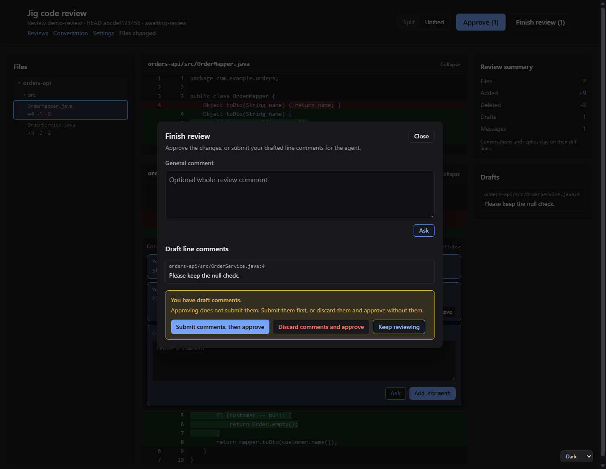

# Jig

[](https://github.com/ClawdBuilder/jig/actions/workflows/ci.yml)
[](LICENSE)

**Jig makes a coding agent's work visible, bounded and yours to approve.**

Jig is a set of plugins for the [Pi](https://pi.dev) coding agent. It decides what the agent may do, asks you when it
matters, keeps credentials out of its reach, and records what happened. The agent keeps its tools; Jig puts one policy,
one approval path and one record around all of them.

Jig never signs in. A credential stays where you already keep it, and a production result is masked before the model
sees it. The same rules govern `bash`, pull requests, Jira, databases, APIs, CI and child agents.

## How it works

- **Every call is classified.** `jig-core` works out the environment and whether a call reads or writes, then applies
  your rules before anything runs.
- **Reads run; writes ask.** A write to a test environment shows a preview and waits for you. Production writes are
  denied, not asked about.
- **Results are cleaned.** Secrets are redacted and production personal data is masked before the model receives the
  result.
- **The record stays.** Each call, approval and cost is in a local record that `jig-lens` can show; nothing leaves the
  machine on its own.
- **The same rules reach `bash` and children.** A sandboxed command and a child agent are governed by the same policy,
  not by a second prompt.
- **Browser pages have one palette.** A graphite dark theme and a light one, following the system or a saved choice;
  [Browser theme](docs/browser-theme.md) has the tokens and the contrast numbers.



*A code review in Jig's browser page, in its graphite theme. The file list and diffs are on the left, the summary stays
beside them, and **Approve** is in the header; approval still returns to Pi. This is example data.*

## Install

Jig needs **Pi 1.4 or later** and **Node.js 22.19 or later**. [Compatibility](docs/compatibility.md) has the tested
versions and the names Jig keeps stable.

```bash
pi install npm:@clawdbuilder/jig
npm install -g @clawdbuilder/jig
```

The first command adds Jig's plugins to Pi. The second installs the `jig` command for terminal commands such as
`jig setup` and `jig doctor`. Neither command starts a session.

Start Pi and run `/jig`. It shows the rules in force, the plugins loaded and anything that needs fixing. For the setup
questions in a terminal, run `jig setup`; [Setup and doctor](docs/setup-and-doctor.md) explains both commands and the
exit codes.

`jig update` moves both copies of Jig to one published version, so an update is one command rather than two;
[Setup and doctor](docs/setup-and-doctor.md#updating) covers what it checks and changes. Pin a release with
`@<version>` after either package name when you want a fixed version.

The launcher is optional: [The launcher](docs/launcher.md) covers tmux, reattaching, the WSL interop repair and the
flags. Jig works without it; `pi install` is all it needs.

### First session

Start Pi in the folder you work in:

```bash
pi
```

Then `/jig` shows the rules and setup state, `/jig doctor` names any missing piece, and `/lens` shows cost and
waiting time after the first calls. A write asks before it runs; a production write is denied.

### Works on

- **Linux and WSL2:** tested in CI and daily use. **macOS:** runs, with Seatbelt in the sandbox; `filtered` and `ask`
  networking mean `off` there ([sandbox](plugins/jig-sandbox/README.md#network)). **Native Windows:** not yet, because of
  the sandbox.
- **Agent:** Pi 1.4 or later, tested with 1.5.0; Jig is a set of Pi plugins, and other agents are not supported.

## What you get

| Area | What it gives you | Plugins |
|---|---|---|
| Safety | One policy for every tool, approvals, secrets, masking, records | [`core`](plugins/jig-core/README.md), [`sandbox`](plugins/jig-sandbox/README.md) |
| Code | Git, pull requests and releases; a browser review; CI and deploy | [`git`](plugins/jig-git/README.md), [`review`](plugins/jig-review/README.md), [`ops`](plugins/jig-ops/README.md) |
| Systems | Jira, logs, saved API requests and MongoDB | [`jira`](plugins/jig-jira/README.md), [`logs`](plugins/jig-logs/README.md), [`api`](plugins/jig-api/README.md), [`mongo`](plugins/jig-mongo/README.md) |
| Work and memory | Workflows with evidence; ticket notes and recall; a card when the agent closes a ticket | [`workflow`](plugins/jig-workflow/README.md), [`memory`](plugins/jig-memory/README.md) |
| Delegation | Child agents under the same rules, with limits | [`agents`](plugins/jig-agents/README.md) |
| Seeing | Cost, failures and waits; session state; themes and a footer | [`lens`](plugins/jig-lens/README.md), [`session`](plugins/jig-session/README.md), [`theme`](plugins/jig-theme/README.md) |

All fifteen plugins are built. Every plugin needs `jig-core`; otherwise they work on their own, and each README is
the specification its code follows. [Herdr](herdr/README.md) is not a plugin: its Work and Context panels read
`jig-session`'s file and show the session in focus.

Company-specific environments, sign-in services and internal tools live in a private company plugin, never here.
[Writing a company plugin](docs/company-plugin.md) and the tested [`jig-acme`](examples/jig-acme/README.md) example
show how; [Plugins](docs/plugins.md) is the map of every tool.

## What is next

Work with a page behind it, not a promise:

- [jig-lens](plugins/jig-lens/docs/later.md): OpenTelemetry export to MLflow, and Datasette charts.
- [jig-memory](plugins/jig-memory/docs/later.md): a memory keeper for organizational and personal facts, ticket text
  from `jig-jira`, and embeddings or a graph only after real-ticket recall shows misses.

## Learn more

- [Your first hour with Jig](docs/first-hour.md): install to your first approval, sandbox check and `/lens`.
- [Architecture](docs/architecture.md): the tool manager, the sandbox boundary and where each plugin fits.
- [Permissions](docs/permissions.md): environments, rules and the floor configuration cannot lower.
- [Plugins](docs/plugins.md): every tool, its actions and the plugin that owns it.
- [Setup and doctor](docs/setup-and-doctor.md): `jig setup`, `jig doctor` and what each finding means.

The longer [reading paths](docs/reading.md) page keeps the order through Approvals, Secrets, Writing a company plugin,
Decisions, Compatibility and the code maps. [Contributing](CONTRIBUTING.md) covers the checks and where code goes;
[Security](SECURITY.md) says how to report a problem; [Releases](docs/releases.md) says what a version means. Every
push runs the type check, Biome, the docs link check, the test suites and the integration services that have an address.

Jig is released under the [MIT licence](LICENSE).
