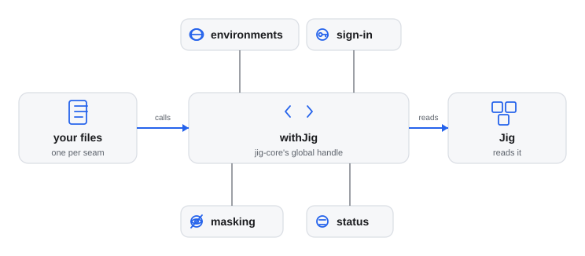

# Writing a company plugin

A company plugin is a small private Pi package that loads after Jig and gives the generic plugins what is particular to one
company: its environments, where its systems are, how to sign in to them, and its rules. It never changes how a tool behaves.
[`examples/jig-acme`](../examples/jig-acme/README.md) is a complete, tested one for a made-up company; copy it.



*One file per seam. Each file calls one thing on `jig-core`, and something in Jig reads the result. This page walks the seams in the
order the example uses.*

## What goes in a company plugin, and what never goes in Jig

| In the company plugin (private) | In Jig (public) |
|---|---|
| The company's name, hosts, addresses, project keys and environment names | Generic names only: `staging`, `orders-api`, `PROJ-123` |
| Defaults for each generic plugin's settings | Each plugin's own defaults and its own checks |
| Secret references, and the command of the tool that owns a login | The reading of a reference, and the redaction of its value |
| The code that signs in, carries a request or opens a tunnel for one employer's systems | The contract those are called through |
| Field names for masking and paths to protect that are the company's own | The masker, the floor and the built-in paths |
| Skill overlays (`overlays/<skill>.md`) with the company's conventions | The generic skill of each plugin |
| An internal tool that exists only at this employer (a deploy tool, a billing system) | A new CI system or database that anyone could use, as an adapter |

- **Configuration and knowledge, not code that changes a tool.** A company gives a tool another site or another sign-in. If a
  tool needs another behaviour, that is a change to the generic plugin, for everyone.
- **No credential, ever.** A company plugin holds secret references and names the tool that owns the login; it never signs in
  ([Credential sources](../plugins/jig-core/docs/sign-in-and-transports.md)).
- **Nothing from here goes into Jig.** Jig's pages and examples use fictional names, so that they go with you to any job.

## The package

A company plugin is a Pi package like Jig itself: a `package.json` with a `pi` block, an entry point, and optionally skills and `overlays/`.

```json
{
  "name": "jig-acme",
  "private": true,
  "keywords": ["pi-package"],
  "peerDependencies": { "@earendil-works/pi-coding-agent": "*", "@earendil-works/pi-ai": "*", "@earendil-works/pi-tui": "*", "typebox": "*" },
  "pi": { "extensions": ["./src/index.ts"], "skills": ["./skills"] }
}
```

- **It reaches `jig-core` through a global handle,** not an import. Pi gives each package its own module root, so a company
  plugin cannot share `jig-core`'s modules. Copy [`client.ts`](../plugins/jig-core/src/client.ts) to `src/jig/client.ts`, and
  import the contract's types only, with `import type`.
- **The factory only registers.** It starts no process, opens no connection, sets no timer and writes no file. The call waits
  when Pi loads the package before `jig-core`, so the order of the packages does not matter to it.
- **Everything goes through one `withJig` callback,** as [`src/index.ts`](../examples/jig-acme/src/index.ts) does.

```ts
export function jigAcme(): ExtensionFactory {
  return () => {
    withJig((jig) => {
      const api = jig.profiles?.register("jig-acme", { displayName: "Acme" }) ?? jig; // seam 8
      registerEnvironments(api);
      registerDefaults(api);
      // ... one call per seam
    });
  };
}
```

## The seams, in order

### 1. Environments

`config.addEnvironments` names the company's systems and says which are test and which are production.
[`environments.ts`](../examples/jig-acme/src/environments.ts) adds `dev` and `staging` as `test` and `prod` as `production`.

- **The kind decides the rules.** A write to a test environment asks, and a write to production is refused (see
  [Permissions](permissions.md)). A name nobody defined counts as production.
- **A test environment can ask to be masked** with `mask: true`, as `staging` does because it holds copies of customer data.
- **These are the names every plugin's settings use:** the keys of `logs.environments`, `mongo.connections` and
  `ops.services.*.environments`.
- **`/jig` lists them,** grouped by who defined them (built in, a company plugin, your `jig.json`). A plugin reads the same list
  with `environments.list()`, so a company plugin keeps no list of its own.

### 2. Section defaults

`config.addSectionDefaults(name, defaults)` gives a plugin's section its company values, so a user writes only what they change.
The nine files of [`defaults/`](../examples/jig-acme/src/defaults) each hold plain data in the shape the plugin's README
documents under "Configure".

| Section | What jig-acme gives it |
|---|---|
| `jira` | The site, a Cloud login by token reference, the project keys, the fields `update` may set, a default priority |
| `logs` | An OpenSearch backend behind the sign-in service, an index per environment, a list filter |
| `mongo` | A connection per environment, a tunnel for two, a production allow list with a reference collection |
| `api` | The folder of saved requests, and environment names, one of them through the transport |
| `ops` | Two services: CI on GitHub Actions, Helm deploys, a Kubernetes context per environment |
| `memory`, `git` | The ticket pattern `ACME-\d+`; the branch and pull request title rules |
| `theme`, `sandbox` | A company palette; hosts the sandbox never connects to |

- **The plugin checks the result,** with the user's section laid over it, when a session starts. A mistake is reported with its key.
- **Give only what is true for everyone.** What only one person knows (an email, a login) is left out, and the user writes it.
  When the defaults alone are not valid, the plugin waits for the user's part and `/jig` says so; nothing is reported as wrong.
- **Defaults are data, not types.** The contract does not describe each section, so a mistake shows only when a session starts.
  That is why [the test](#test-it-the-way-jig-acme-does) loads the real plugins.

### 3. Credentials and sign-in

Jig never signs in; the tool that owns a login does it ([Credential sources](../plugins/jig-core/docs/sign-in-and-transports.md)).
A company plugin connects to that tool with a secret reference, `config.addSecretCommands`, or `signIn.register`.

- **A secret is a reference,** never the secret. A value pasted where a reference belongs is refused, and the message does not
  repeat it ([`config.ts`](../examples/jig-acme/src/config.ts)).
- **A company can turn a secret backend on,** with `config.enableSecretBackends(["cmd"])`, so each user need not add the one its
  sign-in needs. The plugin already runs in Pi with the user's rights, so this gives it nothing new. The user keeps the last word:
  `secrets.disabledBackends` in `jig.json` turns any backend off, and a request then fails with `auth_failed` and says who turned it
  off. Without a company plugin only `pass` is on, and `/jig` lists the backends that are on and who enabled them.
- **Enable only what your own references need.** jig-acme turns on `cmd` and leaves `env`, `file` and the rest to the user.
- **A sign-in service is asked for every request,** with its method, address, headers and body, because it knows when a token has
  run out. `jig-core` hides what it returns from every result ([`signin.ts`](../examples/jig-acme/src/signin.ts)).
- **Serve your own hosts only.** The service is handed the whole address of every request. `acme-sso` refuses a host that is not
  Acme's, and plain http to anything but this machine, so a token cannot be sent where somebody else chose
  ([`hosts.ts`](../examples/jig-acme/src/hosts.ts)).

The calls are in [Credential sources](../plugins/jig-core/docs/sign-in-and-transports.md).

### 4. Transports

`transports.register(name, transport)` carries a whole request, for a system that only the company's proxy may talk to. A plugin
that names it (`transport` in its section) holds no credential at all.

A company that uses a **relay** does not write this code. Set the relay's `kind`, `url`, `services` and `fields` as defaults
for `transports` with `addSectionDefaults("transports", ...)`, and let the person add the `token`. A name registered by
your plugin cannot also be declared in `transports`, in either order. Prefer this for a session relay that follows the
[relay protocol](relay-protocol.md); write a transport only for a route that needs code the protocol does not
carry.
[`transport.ts`](../examples/jig-acme/src/transport.ts) hands the request to a gateway on this machine, as an HTTP proxy is asked.

- **A transport gets** the system, method, address, headers and a text body, and **returns** a status, headers in lower case and
  a text body. It carries `GET`, `POST`, `PUT`, `PATCH` and `DELETE` only.
- **It is told the caller's limits:** `maxBytes` (read no more, and one byte past it so `truncated` can be set) and `timeoutMs`.
  [`transport.ts`](../examples/jig-acme/src/transport.ts) stops reading at the first and drops a stalled gateway at the second.
- **A header the gateway repeated is returned as a list** (`set-cookie` above all), one entry for each time it was sent.
- **It fails with a line that names no address.** The address may hold a query, and `jig-core` never repeats it either.
- **It honours the call's signal,** so a cancelled call stops the request.
- **Nothing in clear text crosses a network.** The example accepts only a gateway on this machine, because it speaks plain http
  to it. A remote gateway needs CONNECT and TLS.

### 5. Tunnels

`tunnels.register(name, provider)` opens a local port that reaches a host the machine cannot reach directly. A tool names it in
its section (`"via": { "tunnel": "acme-bastion" }` in `mongo`), and `jig-core` opens it when a call needs it.
[`tunnel.ts`](../examples/jig-acme/src/tunnel.ts) runs `ssh -L` through the bastion host.

- **Say what the port is.** `forward` reaches the one host and port that was asked for. `socks` is a SOCKS5 proxy that reaches
  any host the far side can, and a replica set needs it.
- **Start the program with `exec.run`.** It takes an argument list, never a shell, and finds the program only in folders the
  agent cannot write. `ssh -N` does not return, so the call is not awaited: closing the tunnel aborts it with a signal.
- **Wait until the port accepts connections,** and until a port that was just freed refuses them, or a closing listener is taken
  for a tunnel that is up. `jig-core`'s `kit/ports.ts` does both (`freePort`, `waitForPort`, and `socksAnswers` for a `socks`
  tunnel), and a package of its own keeps a copy of it, as [`src/jig/ports.ts`](../examples/jig-acme/src/jig/ports.ts) does.
- **Give ssh only what it needs:** the user's agent socket, no configuration file (`-F /dev/null`), and `BatchMode`, so an unknown
  host key is a clear failure and not a question.
- **Say one line when it fails,** such as "the bastion's host key is not trusted", and never ssh's own words, which can hold
  addresses.

### 6. Masking

`config.addMaskFields(names)` lists the fields that hold personal data in the company's own systems.
[`masking.ts`](../examples/jig-acme/src/masking.ts) adds `memberAlias` and `loyaltyCardHolder`.

- **Names match without case or separators,** and their values become `personal#` tokens in a masked result.
- **Jig's own rules stay** (see [Masking](../plugins/jig-core/docs/masking.md)). Add only what Jig does not already know by name.

### 7. Protected paths

`config.addProtectedPaths({ secret, guarded })` adds files that Pi's file tools must not touch.
[`protection.ts`](../examples/jig-acme/src/protection.ts) adds `~/.acme/credentials.json`, where the company's own tool keeps its login.

- **`secret`** is neither read nor written; **`guarded`** can be read, not written. A path is absolute or starts with `~/`.
- **It only adds.** Nothing removes a built-in path or one the user listed.

### 8. Profile and skills

A person may work for more than one company, so a company plugin registers under a name and gives its parts through the view that call
returns. Only the company the work belongs to applies ([Profiles](../plugins/jig-core/docs/profiles.md) says how it is chosen).
[`index.ts`](../examples/jig-acme/src/index.ts) does it in four lines:

```ts
withJig((jig) => {
    const api =
        jig.profiles?.register("jig-acme", { displayName: "Acme", overlays: OVERLAYS, skills: ["acme-releases"] }) ?? jig;
    // ... every seam above uses `api`
});
```

- **Use the returned view for everything.** What the plugin adds through it (environments, rules, defaults, secret commands and backends,
  status lines) applies while the company is active. Protected paths and mask fields always apply, because they only protect.
- **The `?? jig` keeps it working on a Jig without profiles,** where what is added applies always, as it did.
- **A plugin that never registers keeps working,** and applies always. With no `profiles` section and one registered company, that
  company is active.
- **`onChange(active)` is for tools only this company has.** Register them with `exposure: "hidden"` when it is called with `false`,
  and as they were with `true`. Pi cannot unregister a tool.

Skills come in two kinds:

| Kind | Where it lives | What the model sees |
|---|---|---|
| Overlay | `overlays/<skill-name>.md`, plain Markdown, no front matter | The generic skill with a section `## Acme rules` added |
| Company-only skill | `skills/<name>/SKILL.md`, loaded by the manifest (`pi.skills`) | A normal skill, listed while the company is active |

- **An overlay is read with the generic skill,** in one file, so its rules are never missed and the model sees one description per
  trigger. [`overlays/jira.md`](../examples/jig-acme/overlays/jira.md) holds Acme's Jira conventions. Do not repeat the generic skill:
  add only what it cannot know (projects, fields, workflow, manners), starting at heading level 3.
- **The overlay's file name is the generic skill's name.** An overlay with no generic skill loaded applies to nothing, and `/profile` says so.
- **A company-only skill is for what has no generic counterpart,** such as an internal deploy tool. List its name in `skills` when you
  register, so it is left out of the list while the company is dormant. Keep it short, and quote a description that holds a colon:
  Pi skips a skill whose front matter is not valid YAML, and the agent silently loses it.
- **A link in the generic skill that stays inside its folder keeps working,** because jig-core copies the folder's other files beside the
  merged file. A link out of the folder is not rewritten.

#### Moving from `<company>-<skill>` to an overlay

1. Make `overlays/<skill>.md` from the company skill's body: no front matter, drop the title and the "read the generic skill first"
   line, and lower the headings by one level.
2. Delete the company skill's folder. If it was the only skill, drop `pi.skills` from the manifest.
3. Register with `profiles.register(...)` as above and take `displayName` from the old title.
4. A role in `jig-agents` that listed the old skill by name now lists the generic one: the overlay comes with it.
5. Run the tests: the merged text is the generic file, then `## <displayName> rules`, then your overlay.

### What else a company can add

- **`config.addRules` and `config.addClassifyRules`** for its own tools, or an MCP tool, so a call is classified and decided
  by a rule you wrote ([configuration](../plugins/jig-core/docs/configuration.md)).
- **`config.registerSection`** for the company's own settings, as [`config.ts`](../examples/jig-acme/src/config.ts) does with
  `acme`: the few things that differ from one person to the next.
- **`status.register`** for lines in `/jig`, as [`status.ts`](../examples/jig-acme/src/status.ts) does: what is set up, and what this
  user is still missing.
- **`onboarding.register`** for what each person must supply, so `/jig setup` asks in your words and order, and `/jig doctor` says
  what is still missing (see 9).
- **Events** from `jig-lens` (names for the models) and `jig-theme` (footer parts), described in their READMEs.

### 9. Onboarding: what your people must supply

Setup and doctor can ask about your company's fields in your words, in your order: where a token lives, your login on the
bastion host, which proxy to use, and the logins your tools need. It is optional. A plugin with no list is still set up from
its section validators, with plainer labels; a list only makes the flow read like your company.

```ts
api.onboarding?.register({
    preferredStore: "cmd",
    items: [
        { kind: "info", label: "Acme SSO", detail: "The acme-sso command signs you in." },
        {
            kind: "reference",
            section: "acme",
            path: "sso.token",
            label: "The Acme SSO token",
            stores: ["cmd", "pass", "op", "env"],
            suggested: { cmd: "cmd:acme-sso", pass: "pass:acme/sso-token" },
            addHints: { cmd: "acme-sso login", pass: "pass insert acme/sso-token" },
        },
        { kind: "text", section: "acme", path: "bastion.user", label: "Your login on the bastion host", placeholder: "jdoe" },
        { kind: "login", tool: "gh", status: ["gh", "auth", "status"], login: "gh auth login", label: "GitHub login" },
    ],
});
```

- **`section` and `path` are where the answer goes:** a dotted path inside one of your sections (`bastion.user`, `sso.token`),
  so the validator you already wrote is the check.
- **`reference` is a credential, never a value.** `suggested` gives a reference *shape* per store and `addHints` what to tell the
  person to add it; setup shows both, and `preferredStore` (on the item, or the entry) is offered first. Setup never asks for the
  token itself.
- **`login` is a command, not a credential.** Doctor runs `status` and says whether it is signed in; setup prints `login` and does
  not run it. A tool already checked by Jig (gh, glab) is not checked twice.
- **`info` comes before the questions and `pick` offers your plain choices.** Items are asked in your order, and the sections you
  name come first; the rest of the settings keep their own order.
- **It goes through the profile view,** next to `status.register`, so only the active company's list applies. A plugin that never
  registers a profile applies always, as with every other seam.
- **Keep every label and hint plain.** They are what a person reads on their first day: say where a thing lives and why it is
  needed, not what the setting is called.

`jig-acme`'s list is [`src/onboarding.ts`](../examples/jig-acme/src/onboarding.ts); its test checks it with jig-core's own
validator, and `plugins/jig-core/test/setup-onboarding.test.ts` shows the plan that comes out.

## How your `jig.json` layers over the defaults

The user's own `~/.jig/jig.json` is laid over the company's defaults before the plugin checks the result.

| Your value | What happens |
|---|---|
| An object | It merges with the company's, key by key |
| A list, a string, a number or a flag | Yours replaces the company's |
| An object in a key the plugin names in `replace` | Yours replaces the company's whole, so the two never make a mix |
| A key that excludes another (`oneOf`) | The company's value for the other keys is dropped |
| A list in a key the plugin names in `union` | The company's entries first, then yours, each once |

- **`replace` is for one choice among several.** A Jira `auth` of `{ signIn }` and one of `{ email, token }` are alternatives:
  merged, they would make a login that is neither.
- **`oneOf` is for two keys that exclude each other,** such as `logs.backend.auth` and `logs.backend.transport`. Setting one
  removes the company's other.
- **`union` is for a list that you and the company both add to,** such as the folders `workflow` reads workflow files from.
  Replaced, a folder of yours would take the company's away.
- **Each plugin names its own keys.** A key is a path from the section's root, with `*` for any one name.

| Section | `replace` | `oneOf` | `union` |
|---|---|---|---|
| `jira` | `auth` | none | none |
| `logs` | `backend.auth` | `backend.auth`, `backend.transport` | none |
| `mongo` | `connections.*.via`, `connections.*.*.via` | none | none |
| `api` | `environments.*` | none | none |
| `ops` | `services.*.ci.auth`, `services.*.environments.*.job.auth`, `services.*.environments.*.deploy` | none | none |
| `workflow` | none | none | `folders` |

The other sections merge as plain data. With jig-acme loaded, these are the results the tests check:

| You write | You get |
|---|---|
| `{ "jira": { "site": "https://acme-eu.atlassian.net" } }` | Your site, and the company's login and fields |
| `{ "jira": { "auth": { "signIn": "acme-sso" } } }` | Only the sign-in service; the email and token are gone |
| `{ "logs": { "backend": { "auth": { "apiKey": "env:MY_KEY" } } } }` | Your key in place of the sign-in service; the URL stays |
| `{ "logs": { "backend": { "transport": "acme-gateway" } } }` | The transport, and the company's `auth` is dropped |
| `{ "mongo": { "connections": { "dev": { "user": "jdoe" } } } }` | Your user; the address and password stay |
| `{ "git": { "protected": ["main"] } }` | Your list, not the company's two entries |

A section that does not fit is reported with its key, and the plugin does not run half set up. If the user's section is complete
without the defaults, the plugin gets it as written.

## Test it the way jig-acme does

A company plugin is configuration, so its tests load the real thing and look at what comes out. Nothing contacts a real system.

- **Load the real `jig-core` and every plugin you configure** into the fake Pi that `jig-core`'s own tests use, with a `jig.json`
  in a temporary agent folder, then start a session. [`test/support/world.ts`](../examples/jig-acme/test/support/world.ts) does it.
- **Check that nothing is reported** at start-up or in `/jig`, that each section you gave defaults for is valid, and that `/jig`
  lists the environments (the company's among them) and the company's status.
- **Check the profile:** that the company is active by folder, by remote, by name and as the only company, and dormant otherwise
  (a `staging` that is test while active and production while dormant). [`test/profiles.test.ts`](../examples/jig-acme/test/profiles.test.ts)
  does, with the real `jira` skill, and checks the merged `SKILL.md` and the turn's skill list.
- **Check the layering** with small `jig.json` files: one change each, and what the plugin gets back. Cover each `replace` and
  `oneOf` key you rely on.
- **Run the code against fakes.** A fake server on `127.0.0.1` for a sign-in service and a transport, and a fake `ssh` script first on
  `PATH` for a tunnel, in a temporary folder outside the working folder, which `exec.run` requires.
- **Check what must not happen:** a request for another host is refused and nothing is sent; a token is not in a reply or a message;
  a program in the working folder is not run.
- **Keep the copy of `client.ts` identical to `jig-core`'s,** and test that it is. So is the copy of `kit/ports.ts`, if you
  write a tunnel.
- **Build a fake credential at run time** from parts. Push protection rejects a commit that holds one, even a fake one
  ([AGENTS.md](../AGENTS.md)).

In a repository of your own, Jig is a neighbour at development time and not a dependency, because Node does not strip types under
`node_modules`:

- **Link a checkout of Jig** next to the plugin (a `.jig` folder, made by a small script such as `scripts/link-jig.mjs`), and re-export
  the contract's types from it in `src/jig/types.ts`.
- **Import the plugins and test helpers** from that link, as `world.ts` does with relative paths here.
- **Record the Jig commit you built against,** and warn when the checkout is older.
- **The fake Pi has what the Jig plugins call.** Besides `jig-core`'s own calls it has `registerEntryRenderer`, `registerMessageRenderer`,
  `appendEntry`, `sendUserMessage`, `getThinkingLevel` and `sessionManager.getBranch`, and records what a plugin sent through
  them, so `world.ts` needs no stand-ins. A call it still lacks is added to `plugins/jig-core/test/support/fake-pi.ts`.

## Keep it private

- **Put it in a repository of its own,** at the company, and never push it to a public host. It holds the company's hosts, names and
  conventions.
- **Install it beside Jig,** from a source you can read, in Pi's package list. It works whichever loads first.
- **Keep Jig generic.** A change to a generic plugin that a company needs (another CI system, a new field) goes into Jig without
  the company's name. A company name, a host or an environment name in this repository is a mistake.
- **Pin what you built against,** so an upgrade of Jig is a decision and the tests tell you what changed.
