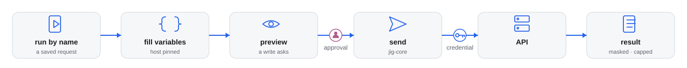

# jig-api: your team's saved API requests, run safely

**Status: built.** Saved requests from Postman, `.http` files, Bruno, OpenAPI and Hurl run through `jig-core`.
- **Postman** collection files (v2.1, with environment files);
- folders of **`.http` files**;
- **Bruno** collections (OpenCollection YAML and `.bru`);
- **OpenAPI** specs;
- a **Postman cloud** workspace.

`jig-api` lets the agent run the API requests your team already keeps, by name,
filling only their variables. Wherever the collection lives, sign-in is added by
the tool, and the result is governed like every other call.

For example, after deploying a change to `staging`, the agent runs your saved
**Get order** request with `orderId=123`. It reads, so it runs at once. Your
saved **Create order** asks you first, showing the exact request; in
`production` the floor denies it.



*How a saved request runs. Collections are read into one list; the agent runs one by name and fills only its variables. A write is previewed and asks you, `jig-core` sends it with the credential, and the answer comes back with secrets removed, masked in production, and capped.*

## What it is for

- **Check a deployed change:** run a saved request against `staging`.
- **Reproduce a ticket's bug:** run the saved write with the ticket's data in
  `staging`; you approve it.
- **Read production state safely:** run a saved read in `production`; the result
  is masked, and writes are denied.
- **Smoke-test after a deploy:** run a folder of saved requests and get one line
  per request.
- **Try an endpoint nobody saved yet:** an ad-hoc call, in a test environment you
  allowed.

## Where collections come from

| Source | Where teams keep it | Status |
|---|---|---|
| **Postman** | Collection v2.1 JSON and environment exports ([details](docs/postman.md)) | built |
| **`.http` files** | Files in git: JetBrains, VS Code, Visual Studio ([details](docs/http-files.md)) | built |
| **Bruno** | Files in git: OpenCollection YAML, or `.bru` ([details](docs/bruno.md)) | built |
| **OpenAPI** | The service's spec, for the environments you list ([details](docs/openapi.md)) | built |
| **Postman cloud** | A workspace, by id with an API key, fetched by `/api refresh` ([details](docs/postman-cloud.md)) | built |

A source is a small adapter, so others can be added ([how](docs/sources.md)).

`/api refresh [collection]` is yours to type: it fetches Postman cloud collections
to their local copy and says what changed.

## Tool: `api`

| Action | Kind | What it does |
|---|---|---|
| `list` | read | Saved requests by collection and folder, with method, address and variables |
| `show` | read | One request in full: address, headers, body, where each variable gets its value |
| `run` | depends on the request | Runs one saved request in an environment, with variables |
| `run_folder` | the strictest of its requests | Runs a folder in order, stopping at the first failure |
| `call` | depends on the method | An ad-hoc request where you allowed it. Off by default, never production |
| `postman_environments` | read | The names and ids of the Postman environments a key can see, never their values |

- **`list`** can filter by text, and says whether each request reads.
- **`run`:** `GET`, `HEAD` and `OPTIONS` read; other methods write, unless the
  request is in `reads` — and in production only those three methods read, so a
  `POST` search listed there is a write there and the floor denies it.
- **`run_folder`** gives one line per request.
- **`postman_environments`** uses a Postman cloud collection's key, to find the id to map
  ([Listing environments](docs/postman-cloud.md#listing-environments)).

A request's name is its action, so a rule can name one request:
`{ "tool": "api", "action": "Create order", "environment": "staging", "decision": "allow" }`.
Parameters and their checks: [Parameters](docs/parameters.md).

## Rules

- **Saved requests first.** The agent fills variables; it cannot change a request's host, method
  or headers ([Variables](docs/variables.md)). Ad-hoc calls are opt-in per environment.
- **Requests are sent by the tool, not by your API client.** Scripts never run: a request that a
  pre-request script applies to is refused, with its name. Test scripts are ignored, with a note.
- **Hosts are pinned per environment.** A request whose host is not one of its environment's
  hosts is refused. So are link-local and cloud-metadata addresses. Redirects are never
  followed, and no cookies are kept ([Safety](docs/safety.md)).
- **Secrets never come from the model.** A secret variable needs a reference in `api.secrets`,
  such as `pass:orders/token`. A plain value for it in a file is refused, with a warning that
  names the file and the variable. Bruno's `{{process.env.NAME}}` and an OpenAPI security scheme
  are secrets too; no `.env` file is read.
- **OpenAPI is opt-in.** A spec runs only in the environments you list, against the servers you
  map to them, and in production only for reads with `allowProductionReads`.
- **Limits.** An upload must sit inside its collection folder. Sign-in is
  headless only: bearer, Basic, an API key in a header, OAuth with client
  credentials or a password grant ([Sign-in](docs/auth.md)). Requests are plain
  HTTP; GraphQL is a `POST` and works, while gRPC, WebSocket and MQTT requests are
  listed and refused, not skipped silently.
- **The rest is `jig-core`'s:** reads run, a write to a test environment asks with a preview,
  and production is denied and masked. [Approvals](../../docs/approvals.md#preview-digest-and-a-lost-reply)
  has the digest and lost-reply rule.

## Configure

In `~/.jig/jig.json`, under `api`. An unknown field is an error, and the tool
then does nothing until the file is fixed (`/jig` lists the problems).

```json
{ "api": { "collections": { "orders": { "http": "~/work/orders-api/http" } }, "environments": { "Staging": "staging" } } }
```

| Field | Meaning |
|---|---|
| `collections` | Named sources: `postman`, `http`, `bruno` or `openapi`. Paths start with `~/` or `/` |
| `environments` | Your collections' environment names, mapped to `jig-core`'s |
| `secrets` | Secret variables, by name, mapped to secret references |
| `reads` | Requests that read although their method is not `GET`. Outside production only: in production only `GET`, `HEAD` and `OPTIONS` read |
| `adHoc` | `jig-core` test environments where `call` is allowed |
| `timeoutSec` | Seconds to wait for an answer: 1 to 120, default 30 |
| `allowPlainLocal` | Allows `http://127.0.0.1` and `http://localhost`. Default `false` |

An environment name that is not mapped counts as production. Every field, with an
example of each source, is in [Configuration](docs/configuration.md).

## Company part (in the company plugin)

- where its collections live, and their environment mapping;
- a transport or a sign-in service, for APIs only reachable through a bastion host, a VPN or a
  sign-in proxy, named in `environments`.
- Your `api` section is laid over its defaults, so you write only what you change. An entry of
  `environments` of yours replaces the company's whole, so it never names both a sign-in service
  and a transport.

## Later

- **Hurl, Insomnia and Postman's YAML layout** as sources.
- **Collections with scripts,** run by their own CLI only in a test environment you
  opt into, with the output masked again.
- **Asserts,** as declared in Bruno and Hurl files. Bruno's are read and shown
  today; `run_folder` would report them.
- **The Postman CLI and `bru`,** so those tools sign in themselves. Jig never signs in
  ([Credential sources](../../plugins/jig-core/docs/sign-in-and-transports.md)).

## Layout

- `index.ts`: the entry Pi loads; it hands on to `src/index.ts`.
- `src/`: the implementation, its checks and the parts it runs on.
- `skills/`: the skill text; read it before the first call.
- `test/`: the unit tests, fake hosts and real-program tests.
Every file: [Code map](docs/code-map.md).

## More detail

**Use it**
- [Postman](docs/postman.md): Read about Postman.
- [`.http` files](docs/http-files.md): Read about `.http` files.
- [Bruno](docs/bruno.md): Read about Bruno.
- [OpenAPI](docs/openapi.md): Read about OpenAPI.
- [Postman cloud](docs/postman-cloud.md): Read about Postman cloud.
- [Variables](docs/variables.md): Read about Variables.
- [Parameters](docs/parameters.md): Read before you call it.
- [Results](docs/results.md): Read when a result surprises you.

**Set it up**
- [Configuration](docs/configuration.md): Read before you add settings.
- [Sign-in](docs/auth.md): Read before you set up a login.

**Trust it**
- [Safety](docs/safety.md): Read before you point it at a host.
- [Writes](docs/writes.md): Read before a write asks.
- [Not verified yet](docs/not-verified.md): Read before you rely on it.

**Change it**
- [Code map](docs/code-map.md): Read before you change the code.
- [Adding a source](docs/sources.md): Read before you add a source.
