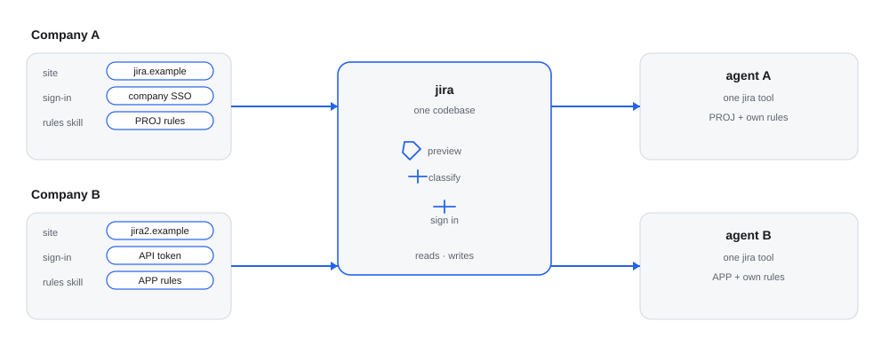

# jig-jira: Jira issues

**Status: built.** One tool over Jira REST v2, in wiki markup, on Cloud and Data Center.

`jig-jira` gives the agent one tool, `jira`, over Jira's REST API version 2,
which takes wiki markup and works on Jira Cloud and on Jira Data Center. Every
write shows a rendered preview before it is sent, and `jig-core` governs every
call.

For example, `jira comment` on `PROJ-123` shows the comment as Jira will render
it, and posts it only after you press `y`.



*The same `jira` tool for two companies. The difference is configuration and knowledge, not code: each company plugin supplies its own site, sign-in, ticket key pattern and an overlay skill, which is its own rules added to this plugin's skill.*

The same tool previews text, classifies every action as read or write, signs in through the company's method, and reads and writes Jira; only the site, sign-in, keys and skill change.

## Tool: `jira`

`action` picks the operation. Calls run one at a time, in order.

| Action | Kind | What it does |
|---|---|---|
| `get` | read | An issue's fields, description and latest 5 comments |
| `search` | read | Issues matching a JQL query, with paging; with `commented`, the issues a person commented on |
| `comments` | read | The newest comments, up to 100 |
| `transitions` | read | The transitions available, with their target status |
| `changelog` | read | Status and field history |
| `attachments` | read | The list of attachments; files are not downloaded |
| `assignable` | read | Users who can take the issue |
| `find_field` | read | Field ids and names matching a text |
| `link_types` | read | The link types, with what each end reads, such as `blocks` and `is blocked by` |
| `create` | external write, asks on the review screen | Creates an issue; the preview shows every field and possible duplicates |
| `comment` | external write, asks on the review screen | Adds a comment |
| `edit_comment` | external write, asks on the review screen | Replaces a comment's text |
| `delete_comment` | external write, asks on a dialog | Deletes a comment. This cannot be undone |
| `transition` | external write, asks on a dialog | Moves the issue; the name must match exactly one transition |
| `update` | external write, asks on a dialog; review screen when it sets the description | Sets allowed fields such as summary, labels, priority or assignee |
| `link` | external write, asks on a dialog | Links two issues with a link type; the preview names both and the type |
| `unlink` | external write, asks on a dialog | Removes the link between two issues; the preview names both and the type |

Writes go to `external` (or the environment you set), so they ask you by
default. Each action's parameters, and the limits on what the tool returns, are
in [Parameters](docs/parameters.md).

## Finding issues by who commented

JQL has no "commented by" (only an app, ScriptRunner, adds one), so `search` takes a `commented` filter. `from` and `to` are whole
days on your own clock, midnight to midnight, and both days are included.

```json
{ "action": "search", "jql": "project = PROJ", "commented": { "by": "me", "from": "2026-10-01", "to": "2026-10-31" } }
```

- **Candidates:** the issues of your JQL (or of `projects`) updated since `from`, at most 500. More is refused, with advice on narrowing.
- **Exact check:** every comment of each candidate is read, and an issue matches when one is by that person and was created in
  the days. A match is listed with the ids and dates of those comments, not their text.
- **Two methods:** `read` reads the comments. `scriptrunner` lets ScriptRunner's `commented()` shorten the list of candidates where
  the site has it; `commentSearch` chooses. `me` names you where the site has no `/myself`.
- **JQL note:** a `search` whose JQL says `labels != x` is told that it also drops issues with no labels (see Rules).

The rules, limits and failures are in [Commented by](docs/commented.md).

## Rules

- **Rendered previews.** Text is Jira wiki markup, and the review screen shows
  it before it is sent. `o` opens the rendered page; the browser only shows,
  and approval stays in Pi.
- **Local-pointer check.** Outgoing text is checked for local paths and for the
  names in `privateNames`. They are flagged in the preview and do not block: you
  decide.
- **Invalid input is not asked about.** Every call is checked before anyone is
  asked, and a mistake blocks the call with a message that says what to change.
- **Your own comments only.** `edit_comment` and `delete_comment` refuse a comment
  by someone else, or when Jira cannot say who you are and `me` is not set.
  `othersComments` allows other people's.
- **Writes are previewed and never resent.** [Approvals](../../docs/approvals.md#preview-digest-and-a-lost-reply)
  has the digest and lost-reply rule; Jira reads the issue once.
- **JQL notes.** A `search` whose JQL says `labels != x` (or `not in`, or the same
  with `component` or `fixVersion`) gets a note: such a clause also drops issues
  that have none. It is a note, never a refusal.
- **Facts.** After a write, the call's record carries the issue key, as the
  fact `issue`. After a `search` with `commented`, it carries `candidates`,
  `matched`, `method` and `unread`.

## Configure

In `~/.jig/jig.json`, under `jira`. An unknown field is an error, and the
tool then does nothing until the file is fixed (`/jig` lists the problems).

| Field | Default | Meaning |
|---|---|---|
| `site` | required | The https address of the Jira |
| `auth` | required | How requests are signed in: five forms |
| `projects` | none | Project keys for `search` without JQL, `create` and links |
| `updateFields` | five common fields | The fields `update` may set |
| `environment` | `external` | The rules environment for this Jira. It cannot be `local` |
| `timeoutSeconds` | `30` | A normal request's timeout, a whole number from 5 to 120 seconds |
| `searchTimeoutSeconds` | `60` | A search's timeout, a whole number from 5 to 120 seconds |

A screen field whose schema says `array` takes one value as a one-item list; the preview says when it wrapped one.

[Configuration](docs/configuration.md) has every field and auth form.

```json
{
  "jira": {
    "site": "https://example.atlassian.net",
    "auth": { "email": "jane@example.test", "token": "pass:work/jira-token" },
    "projects": ["PROJ"],
    "fields": { "Story Points": "customfield_10016" },
    "updateFields": ["summary", "description", "labels", "priority", "assignee", "Story Points"],
    "privateNames": ["payroll", "corp.example.net"]
  }
}
```

## Company part (in the company plugin)

- the Jira site;
- the sign-in: a company sign-in service, a company transport, a relay configured
  in `transports`, or an API token through a secret reference;
- the project keys, so that `search` needs no JQL for them and `create`, `link`
  and `unlink` cannot reach another project;
- default fields: friendly names, the fields `update` may set, and private names — its `privateNames` and yours add up;
- the environment name, when it is not `external`.

## Layout

- `index.ts`: the entry Pi loads; it hands on to `src/index.ts`.
- `src/`: the implementation, its checks and the parts it runs on.
- `skills/`: the skill text; read it before the first call.
- `test/`: the unit tests, fake hosts and real-program tests.

Every file: [Code map](docs/code-map.md).
## More detail

**Use it**
- [Parameters](docs/parameters.md): Read before you call it.
- [Commented by](docs/commented.md): Read before you search by commenter.
- [Wiki markup](docs/wiki-markup.md): Read before you write wiki text.

**Set it up**
- [Configuration](docs/configuration.md): Read before you add settings.

**Trust it**
- [Writes](docs/writes.md): Read before a write asks.
- [Not verified yet](docs/not-verified.md): Read before you rely on it.
