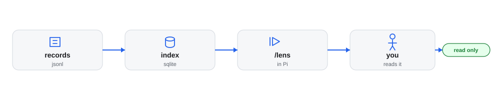

# jig-lens: what happened, and what it cost

**Status: built.** The summary is tested with sample records, a fake Pi and a real Pi session on a scripted model; the RPC notification has a fake screen only.

`jig-lens` shows what `jig-core` [records](../jig-core/docs/records.md): cost, tool failures and time spent waiting.
`/lens` prints a summary inside Pi; `/lens web` opens charts, sessions and tools in your browser. Grafana or Datasette
are optional extras. It never changes the records, and nothing leaves the machine.

`/lens usage` is a quick view of cost and tokens from Pi's own session files;
TokenTelemetry goes further (see [Reuse](../../docs/reuse.md)). `jig-lens` adds what only
Jig's records hold: rule decisions, approvals and time waited, tickets and checks. For
example, `/lens ticket PROJ-123` after a morning's work:

```text
Ticket PROJ-123, all time
  Cost       $1.41 over 6 turns, 309k tokens in (92% read from cache), 6.0k out
             by model  claude-sonnet-5-5  $1.10
                       claude-opus-5      $0.31
  Tools      34 calls, 2 failed, 2 blocked
             failing  bash            2 of 8  tool 2
             slowest  ci watch    p95 4m 10s  1 call
                      bash           p95 12s  8 calls
                      git push      p95 2.4s  2 calls
                      git status    p95 80ms  3 calls
                      read          p95 36ms  12 calls
  Your time  2 questions: 1 allowed, 1 allowed for the session
             waited 53s in total, median 27s
             by tool  git push  53s  2 questions
  Blocked    2 calls
             rule  denied  2  http 2
  Checks     ci watch  conclusion success, failed 0, passed 412  2h ago
```



*How the records reach the screen: `jig-core` appends them, `jig-lens` keeps a copy it can rebuild, the `/lens` summary reads that copy inside Pi, and the `/lens web` page reads it read-only on `127.0.0.1`, behind a secret link.*

## Commands

| Command | What it does |
|---|---|
| `/lens` | Imports new lines, then shows today, this session, and the session's ticket |
| `/lens ticket KEY` | One ticket, over all time |
| `/lens session [id]` | One session. Without an id, this one |
| `/lens days N` | The last N days, from 1 to 90, the last of them today |
| `/lens compare [days N]` | Sessions grouped by condition, side by side, over the last N days (30 by default). See [Comparing conditions](docs/compare.md) |
| `/lens usage` | An interactive view of cost and tokens from Pi's own session files |
| `/lens web` | Imports, starts this session's page on `127.0.0.1` (or reuses it), and opens it. See [The web page](docs/web.md) |
| `/lens grafana` | Imports, starts Grafana if it is not running, and opens its dashboards |
| `/lens datasette` | The same for Datasette |
| `/lens rebuild` | Deletes the index and imports every record file again. The viewers are not touched |
| `/lens status` | The viewer on the port, the index size, the last import, the lines skipped, and the page |

`/lens compare` groups main sessions by the `condition` tag (`$JIG_CONDITION`) and counts a child's lines toward its
parent. A short separate Pi process, such as a judge model call, is a side call: give it a `JIG_AGENT_ROLE` other than
`main` and its cost joins its condition without making it a session.

Anything else, or the wrong arguments (`/lens days 91`), shows the usage line and
does nothing: `Usage: /lens [ticket KEY | session [id] | days N | compare [days N] | usage | web | grafana | datasette | rebuild | status]`.

## Rules

- **Read-only over the records.** They belong to `jig-core`. The index is a copy
  that `/lens rebuild` makes again.
- **Separate from `jig-core`,** so the guard works without the summary.
- **The summary is for you, not the model.** In a terminal it is a session entry that the model never
  receives; over RPC, a shortened notification; with no screen, nothing.
- **Today is your day,** from midnight on your clock, not a UTC day.
- **Text here, charts on a local page.** `/lens web` draws them on `127.0.0.1` only, read-only, behind a
  secret link, and stops with the session. Grafana's sign-in stays on.

## Configure

In `~/.pi/agent/jig.json`, under `lens`. The field is optional. `jig-core` checks
the section when a session starts; a mistake names the key, and the defaults apply.

| Field | Default | Meaning |
|---|---|---|
| `port` | 3300 | The port of Grafana or Datasette on `127.0.0.1`. `/lens web` takes a free port of its own |

```json
{ "lens": { "port": 3300 } }
```

`viewer` is gone: the command names the viewer now (see
[Viewer settings](docs/viewer-settings.md#the-viewer-setting-is-gone)).

## Company part (in the company plugin)

None. Nothing here is specific to a company.

## Later

- **OpenTelemetry export to MLflow,** for trace waterfalls, and **Datasette
  charts** through `datasette-dashboards`.
- **The harness watching itself,** from the records and closed tickets.
- **Not shown yet:** cost while waiting for you (see [The summary](docs/summary.md#not-shown-yet)).

## Layout

- `index.ts`: the entry Pi loads; it hands on to `src/index.ts`.
- `src/`: the implementation, its checks and the parts it runs on.
- `skills/`: none: the tool text is the entry.
- `test/`: the unit tests, fake hosts and real-program tests.

Every file: [Code map](docs/code-map.md).
## More detail

**Use it**
- [The summary](docs/summary.md): Read before you read the summary.
- [Comparing conditions](docs/compare.md): Read before you compare a run.
- [The usage view](docs/usage.md): Read before you read usage.
- [From the records to the index](docs/import.md): Read before you import records.
- [The index](docs/index-schema.md): Read before you query the index.
- [The web page](docs/web.md): Read before you open the page.
- [Viewers](docs/viewers.md): Read before you choose a viewer.
- [Later](docs/later.md): Read only if you plan ahead.

**Set it up**
- [Viewer settings](docs/viewer-settings.md): Read before you change a viewer.
- [Starting Grafana](docs/starting-grafana.md): Read before you start Grafana.

**Change it**
- [Code map](docs/code-map.md): Read before you change the code.
