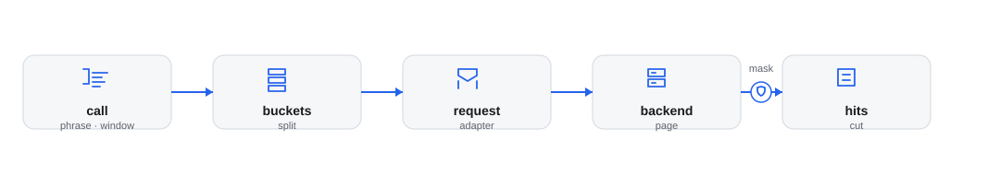

# jig-logs: searching logs

**Status: built.** One `logs` tool searches one backend over a time window.

`jig-logs` gives the agent one tool, `logs`, that searches the logs of one
backend over a time window. It only reads, and `jig-core` governs every call and
masks production results. For example, `logs` with the phrase `req-7f3a9c` in
`staging` searches the last 2 hours and returns how many hits the window holds,
then one line per hit.

*How a search runs. The search splits the window into buckets and the adapter builds one request for each. `jig-core` sends it with the credential, or a company transport does, and the hit lines come back cut and, in production, masked.*

## Backends

`logs.backend.type` picks the backend. `phrase`, `match` and `exclude` mean the
same on every backend, but `query` is in the backend's own language: Lucene for
Elasticsearch, LogQL for Loki. Another backend is one file that implements
`LogBackend`; [Backends](docs/backends.md) says what it must do.

| Backend | Status | `query` is written in |
|---|---|---|
| Elasticsearch and OpenSearch | built | Lucene |
| Grafana Loki | built | LogQL (see [Loki](docs/loki.md)) |
| Datadog | write an adapter | its log search syntax |
| Splunk | write an adapter | SPL |
| CloudWatch Logs | write an adapter | Logs Insights |
| Google Cloud Logging | write an adapter | the Logging query language |
| VictoriaLogs | write an adapter | LogsQL |

## Tool: `logs`

Every call is a read. The tool has no aggregations, dashboards or saved searches,
and does not follow a log as it grows. The first six rows decide what is
searched. `match`, `exclude`, `around`, `chars` and `offset` only choose and shape
the hits already fetched (Loki also receives `match` and `exclude` as filters).

| Parameter | Kind | What it does |
|---|---|---|
| `phrase` or `query` | one of the two | `phrase`: an exact phrase in the message. `query`: a query in the backend's language |
| `environment` | required | Where to search: one of the configured environments |
| `window` | optional | A relative window that ends now, such as `30m`, `2h` or `1d`, up to `maxWindow`. Default `2h` |
| `from`, `to` | optional | Exact times, ISO 8601 with a timezone, `to` exclusive; `from` alone ends now. Up to `maxWindow` |
| `size` | optional | How many hits to fetch, 1 to 200. Default 50 |
| `order` | optional | `asc` (default) fetches the oldest hits of the window, `desc` the newest |
| `match`, `exclude` | optional | Plain texts that a hit's message must, or must not, contain |
| `around` | optional | One plain text: each hit is shown as a window around it |
| `chars` | optional | How many characters a hit keeps, 40 to 4000 |
| `offset` | optional | Which of the fetched hits to start from, for paging |

Start with the narrowest `window` and the smallest `size` that answers the question; a wide window over a busy index is slow,
and the result names any part it could not search.

The limits and the details of each parameter are in
[Parameters](docs/parameters.md).

The result is plain text: a header with the status and the counts, what is
missing, then one line per hit. A wrong call is refused before anything is sent,
with one line that shows the right form, such as `logs does not use limit.
Usage: logs {phrase or query, environment, window?, ...}`.

## Rules

- **It only reads.** A search is a read in the `jig-core` environment that the
  searched environment's `jigEnvironment` names. A production search is allowed,
  and `jig-core` masks the result. This plugin masks nothing itself, and a name
  that `jig-core` does not know counts as production.
- **What the model writes is a value and nothing else.** Each backend builds its
  requests in one place, and the model's text lands in one value of them. A Loki
  `query` is checked so that it cannot change the selector, which only the
  configuration sets.
- **No credential in anything the model reads.** A secret is resolved when a
  request is made and stays in that call. An error names what failed (a status,
  an error code) and never repeats a header, a body, an address or the reply.
- **A result says what it covers.** A call makes a limited number of requests in
  a limited time. A part of the window it could not search is a gap, named with
  its reason, and the total is then "at least" (Loki cannot count, so it always
  is when a bucket filled `size`).
- **Cut is not hidden.** A hit line is cut so that no JSON body or quoted value
  is left open. `{…}` means a body cut for length, not hidden.
- **Invalid input is not asked about,** and facts are recorded: `status`, `hits`,
  `atLeast`, `fetched` and `requests` (see [Failures](docs/failures.md)).

## Configure

In `~/.pi/agent/jig.json`, under `logs`. `jig-core` reports an unknown or invalid
field (one that belongs to the other type is named), and the tool then says it is
not configured instead of running half set up.

| Field | Meaning |
|---|---|
| `backend` | Required. The `type` (`elasticsearch` or `loki`), its `url`, and `auth` or `transport` |
| `environments` | Required, at least one. Each says where its logs are: an `index` or a `selector`, and may add a `filter` |
| `maxWindow` | The longest window one call searches, `1h` to `90d`, written like `window`. Default `7d` |
| `consoleProxy` | Optional. A Dashboards/Kibana console proxy path on the backend origin, such as `/_dashboards/api/console/proxy` or `/api/console/proxy` |

A password, key or token in `auth` is a secret reference such as
`pass:logs/api-key` (see [Secrets](../../docs/secrets.md)), never the secret. A
Loki `selector` comes from here and never from the model. An environment's
`jigEnvironment` is the `jig-core` environment it is classified in, by default its
own name.

[Configuration](docs/configuration.md) lists every field with its default and
limits, and has an example for each type.

## Company part (in the company plugin)

- the backend's type and address, and the indexes or selectors;
- how environments map to the log's own environment names, as `filter` or in the
  `selector`, and to `jig-core` environments, as `jigEnvironment`;
- the sign-in: a company sign-in service (for example a single sign-on gateway),
  or a company transport registered with `jig-core`. A transport carries each
  request and signs it in, so `backend` holds `{ "transport": "<name>", "url" }`
  in place of `auth`, and its `url` may be `http://`. A relay configured under
  `transports` is named the same way; see the
  [relay protocol](../../docs/relay-protocol.md).

## Later

- **Requests signed with AWS credentials,** and the other backends above, when a
  job needs them and not before.

## Layout

- `index.ts`: the entry Pi loads; it hands on to `src/index.ts`.
- `src/`: the implementation, its checks and the parts it runs on.
- `skills/`: the skill text; read it before the first call.
- `test/`: the unit tests, fake hosts and real-program tests.

Every file: [Code map](docs/code-map.md).
## More detail

**Use it**
- [Parameters](docs/parameters.md): Read before you call it.
- [Backends](docs/backends.md): Read before you add a backend.
- [Loki](docs/loki.md): Read before you use Loki.
- [Query grammar](docs/query-grammar.md): Read before you edit a query.
- [Windows and buckets](docs/windows-and-buckets.md): Read before a wide search.
- [Hit lines](docs/hit-lines.md): Read when a hit line is cut.

**Set it up**
- [Configuration](docs/configuration.md): Read before you add settings.
- [Connecting](docs/connecting.md): Read before you connect a backend.

**Trust it**
- [Failures](docs/failures.md): Read when a search leaves a gap.
- [Not verified yet](docs/not-verified.md): Read before you rely on it.
