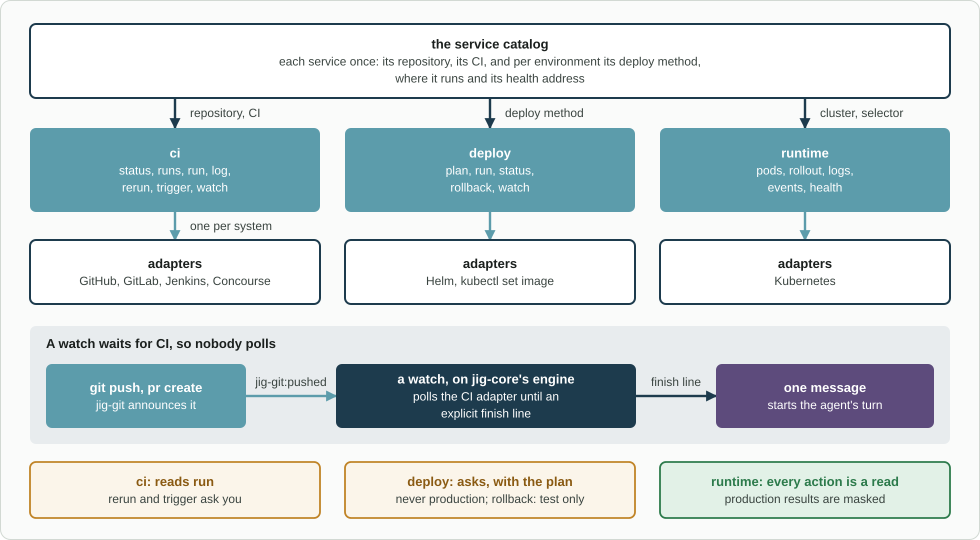

# jig-ops: build, deploy and run, on any CI and any platform

**Status: built.** `ci`, `deploy` and `runtime` cover build, deploy and run on any CI and platform.

`jig-ops` covers what happens after the code is written: did CI pass, can it go to a
test environment, is it healthy, and what do the logs say. You describe each service
once, in a **service catalog**, and the agent uses the same verbs whatever your CI,
deploy method and platform are. `jig-core` governs every call.

For example, "push, wait for CI, deploy 1.4.3 of `orders-api` to staging and check
it": a watch reports when CI ends, `ci log` says why if it failed, `deploy run` asks
you with the exact command, and `runtime` checks it.



*The catalog feeds three tools, each with an adapter per system. A watch waits for CI: `jig-git:pushed` starts it, and one message wakes the agent when its finish line is reached. Deploys and reruns ask you, and production is never deployed to.*

## The service catalog

In `~/.jig/jig.json`, under `ops`:

```json
{"ops": {"services": {"orders-api": {
  "repo": "acme/orders-api",
  "ci": {"system": "github-actions", "workflow": "build.yml"},
  "environments": {"staging": {
    "deploy": {"method": "helm", "release": "orders-api", "chart": "deploy/chart"},
    "runtime": {"kubernetes": {"context": "staging", "namespace": "orders", "selector": "app=orders-api"}},
    "health": "https://api.staging.example.com/orders/health"}}}}}}
```

| Field | Meaning |
|---|---|
| `repo` | Where the code lives, for finding the CI run of a commit |
| `ci` | The CI system and where it is: GitHub Actions, GitLab CI, Jenkins or Concourse, with its address and sign-in |
| `environments` | Per environment: its `deploy` method (or a read-only `pinned`), where it runs (`runtime`), its `health` address and the CI `job` that acts on it |

- **`production` has no `deploy` on purpose.** Without `deploy`, the agent cannot
  deploy to an environment.
- **An unknown field is an error,** and the tools then do nothing until it is fixed
  (`/jig` lists the problems).
- **An environment's name is also the name `jig-core` knows it by,** and an unknown
  name counts as production, so define your test environments in `jig.json`.

All fields (and how CI watches poll): [The catalog](docs/catalog.md).

## Tools

### `runtime`

| Action | Kind | What it does |
|---|---|---|
| `pods` | read | A service's pods: ready, status, restarts, age, version |
| `rollout` | read | The workload and a verdict: `Running`, `Still rolling`, `Failing`; `waitFor` waits for a version |
| `logs` | read | The last lines of one pod's log, or of its previous run |
| `events` | read | Recent events about the service's objects, such as failed scheduling |
| `health` | read | A `GET` on the health address, or curl in a pod where the catalog says so; never a production pod |

### `deploy`

| Action | Kind | What it does |
|---|---|---|
| `plan` | read | The versions running now, the one asked for, and the command; for a pin, the line it would change |
| `run` | write in the environment | Deploys a version with the environment's method. Asks you, with the plan as the preview |
| `status` | read | The last deploy run from here and the rollout; for a pin, what it pins, for whom and since when |
| `rollback` | write in the environment | Back one revision, in a test environment only. Asks you |
| `watch` | local write | Waits until every pod is ready on the version, one cannot come up, or time runs out |

A **pin** (a version line in a control repository) is read by `deploy status` and `deploy plan`; `deploy run` is not built for it yet ([Deploy](docs/deploy.md#pins)).

### `ci`

| Action | Kind | What it does |
|---|---|---|
| `services` | read | The catalog's services with a ci entry, one line each with its CI system |
| `status` | read | The checks or jobs of a pull request, branch, commit or run, counted as pass, fail, pending, skipped |
| `runs` | read | Recent workflow runs, pipelines or builds, by branch, commit or state |
| `run` | read | One run's jobs and steps (GitHub also its artifacts), a pipeline's jobs, or a build's stages |
| `log` | read | A failed job's log: the tail, or the lines matching a search; capped at 400 lines and scrubbed |
| `rerun` | external write, asks | The failed jobs of a run or pipeline (GitHub also the whole run). Not Jenkins or Concourse |
| `trigger` | external write, asks | A GitLab pipeline on a ref, a Jenkins build with parameters, or a Concourse job. Not GitHub Actions |
| `watch` | local write | Waits in the background until a finish line (the required checks, a named one, a run) |

An action or parameter the CI system of the service lacks is refused, naming the adapter ([CI](docs/ci.md)).

Every action takes an `environment`. The call then acts on that environment's CI `job` (a Concourse job that deploys it, say)
and in that environment: reads are reads there, a `trigger` is a write there, and production is denied ([CI jobs](docs/ci.md#a-ci-job-per-environment)).

## Adapters

| Area | Built | Later, or added by anyone |
|---|---|---|
| CI | GitHub Actions, GitLab CI, Jenkins, Concourse | Buildkite, CircleCI |
| Deploy | Helm, `kubectl set image`, a version pin in a control repository (reads) | Writing a pin through a pull request, Argo CD, Flux, platform CLIs |
| Runtime | Kubernetes | Docker Compose, ECS, Cloud Run |

## Rules

- **Reads run; writes ask.** Production is denied and masked by the floor
  ([Permissions](../../docs/permissions.md)). The CI host is `external` unless the
  catalog names its environment, or the call names one with a `job`.
- **Arguments, never a shell.** `gh`, `kubectl` and `helm` get their repository, context,
  namespace, release, chart and values from the catalog, never from the model. So do
  GitLab, Jenkins and Concourse their address, project, team, pipeline and job.
- **A pin is read through `gh api`,** with the repository, branch and file paths from the catalog, never from a call. Reading it
  changes nothing; a file whose pattern matches two lines, or none, is refused with the line numbers and not their text.
- **A few named writes:** `helm upgrade --install`, `helm rollback`, `kubectl set image`,
  `kubectl rollout undo`, and in CI a rerun and a trigger. No delete, scale, arbitrary
  exec or port-forward. A version is checked to be an image tag.
- **Never production.** A deploy, a rollback or curl in a pod there is blocked before
  anyone is asked.
- **A preview is tied to the run.** If what runs now differs from what you approved,
  nothing is run: "changed since the preview". A command or request cut short, with an
  unknown outcome, is never sent again; the state is read once.
- **Credentials stay with you.** `gh`, `kubectl` and `helm` use their own sign-in. A
  GitLab, Jenkins or Concourse token is a secret reference, a sign-in service or a transport. Jig never
  signs in: when Concourse refuses the login, the message says how you renew it.
- **A watch has an explicit finish line,** never "all checks"; one message wakes the agent.

## Events

- **`jig-git:pushed`** (listened to) starts a watch on the pushed commit of a service with
  that `repo` and a `ci` entry (`ops.watch.auto`). The payload is checked.
- **`jig-ops:artifact-ready`** (published) says a build, tag or release exists for a passed
  watch: `{ repo, pr?, sha, kind, ref, source }`. It was `jig-git:artifact-ready`.
- **`jig-ops:ci-finished`** (published) says a CI watch ended `passed` or `failed` for a commit:
  `{ repo, service, system, sha, branch?, pr?, finish, outcome, summary }`. `jig-workflow`'s
  `checks-pass` listens for it.

## Configure

In `~/.jig/jig.json`, under `ops`. [The catalog](docs/catalog.md) has every field and what is checked.

## Company part (in the company plugin)

- its service catalog, test environments and "artifact ready" rules; later, its deploy
  methods, and sign-in services, transports and token commands for CI servers behind a VPN or proxy.
- Your `ops` section is laid over its defaults, so you write only what you change. A CI `auth`, the `auth` of an
  environment's `job` and a `deploy` entry of yours replace the company's whole, and the rest merges key by key.

## Later

- More CI systems (Buildkite, CircleCI), one file each, and artifact rules per service.
- `deploy run` and a watch for a pin (a pull request that changes the version line), Argo CD, Flux, ECS, Cloud Run and Docker Compose (Docker access
  is root, so with care), and a Terraform plan, as a read.
- One shared catalog for `jig-logs`, `jig-api` and `jig-mongo` too.

## Layout

- `index.ts`: the entry Pi loads; it hands on to `src/index.ts`.
- `src/`: the implementation, its checks and the parts it runs on.
- `skills/`: the skill text; read it before the first call.
- `test/`: the unit tests, fake hosts and real-program tests.
Every file: [Code map](docs/code-map.md).

## More detail

**Use it**
- [CI](docs/ci.md): Read before you use CI.
- [Runtime](docs/runtime.md): Read before you read a service.
- [Deploy](docs/deploy.md): Read before you deploy.

**Set it up**
- [Configuration](docs/configuration.md): Read before you add settings.
- [The catalog](docs/catalog.md): Read before you add a service.

**Trust it**
- [Not verified](docs/not-verified.md): Read before you rely on it.

**Change it**
- [Code map](docs/code-map.md): Read before you change the code.
