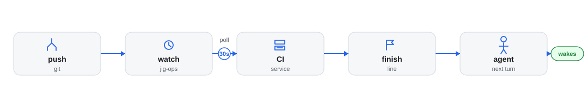

# CI: the `ci` tool

## CI platforms

| | status, runs, run, log | rerun | trigger |
|---|---|---|---|
| GitHub Actions | yes | yes, no trigger | no |
| GitLab CI | yes | failed jobs only | yes, on a `ref` |
| Jenkins | yes | no | yes |
| Concourse | yes | no | yes, the job, with no `ref` |

How the `ci` tool looks at a service's CI, changes it and waits for it, on GitHub
Actions, GitLab CI, Jenkins or Concourse. Back to the [jig-ops overview](../README.md). The
catalog fields it reads are in [The catalog](catalog.md#ci).

A call names a `service` from the catalog, and the catalog says which CI system
builds it and where. A call never names an address, a project, a job or a
workflow. `jig-core` governs every call, and `ci` was `jig-git`'s `checks` tool
before CI moved here.

## What each system can do

An adapter has the actions it can do and the parameters each takes; the table is
the check. An action it does not have, or a parameter that action does not take,
is invalid input: the call is blocked before anyone is asked, and the message
names the adapter and says what it does have.

| Action | GitHub Actions | GitLab CI | Jenkins | Concourse |
|---|---|---|---|---|
| `status` | checks of a pull request, branch or commit; `required_only` | the pipeline of a branch, commit or id, its jobs counted | the last build or one by number, its stages counted | the newest build or one by number, and whether the job is paused |
| `runs` | workflow runs, by branch, commit or state | pipelines, by branch, commit or status | builds, by result | builds, by status; at most 20 |
| `run` | one run's jobs and steps, and its artifacts | one pipeline's jobs, with why one failed | one build's stages | one build, and the versions of its inputs |
| `log` | a failed job's log | a failed job's log | the console of the last failed build, or of one | a finished build's log; the last failed one, or one |
| `rerun` | the failed jobs, or the whole run | the failed jobs of a pipeline | not offered | not offered |
| `trigger` | not offered | a pipeline on a `ref`, with variables | a build, with parameters | the job, with no ref and no parameters |
| `watch` | the six finish lines below | a pipeline, or named jobs | a build, or named stages | one build to its end |

- **Why Jenkins has no `rerun`.** Its remote API has none: rebuilding is a plugin,
  and a build that took a password as a parameter cannot be rebuilt from what the
  API shows. `trigger` starts a new build with the parameters the call names.
- **Why GitHub Actions has no `trigger`.** Starting a workflow by hand can deploy,
  and deploys have their own tool and their own rules. The catalog's `workflow`
  narrows `runs` to one workflow.
- **Why Concourse has no `rerun`, `ref` or `parameters`.** A job runs what its pipeline pins. Starting the job again is
  `trigger`, and a build has no branch or commit of its own to name.
- **GitLab retries failed jobs only.** To run everything again, `trigger` on the
  same `ref`.
- **A log is capped and scrubbed.** At most 400 lines, the tail or the lines that
  match `grep`; terminal sequences and control characters out, and anything that
  looks like a credential replaced. A log of more than 8 MiB is refused.
  - **`gh` 2.97 and later** refuse to print a log, which is text with colour codes in it, unless `--allow-escape-sequences` is given.
    The plugin gives it when `gh help api` lists the flag (asked once), and an older `gh`, which fails on an unknown flag, is not given it.

## Classification, previews and lost replies

- **Reads are `external` reads and run.** `rerun` and `trigger` are `external`
  writes, so they ask. `watch` is a local write: it starts something on this
  machine and changes nothing at the CI host.
- **The CI host is `external` unless the catalog names an `environment`** in the
  service's `ci` entry. A name `jig-core` does not know counts as production: reads
  there are masked and writes are denied before anyone is asked.
- **A write is previewed.** The preview names the service, what is sent and the
  state it is sent against (the failed jobs of the pipeline, the newest pipeline of
  the `ref`, the next build number). The [digest and lost-reply rule](../../../docs/approvals.md#preview-digest-and-a-lost-reply)
  applies; the tool reads once after a lost reply, so one `rerun` cannot become two.
- **Concourse is started with one POST and no body.** The job's builds are read first: the newest is the baseline, and a
  read that fails means nothing is sent. A paused job or pipeline is refused before anyone is asked.
- **Jenkins needs a crumb for a POST.** It is requested from
  `/crumbIssuer/api/json` before anything is sent; a server with no crumb issuer
  answers 404 and none is used. The session cookie the crumb is tied to goes back
  with the POST. A failure to get the crumb is a plain failure: nothing was sent.

## A CI job per environment

A service has one build CI. The jobs that deploy it differ by environment, and so may the system: one Concourse job for staging,
a Jenkins job for another environment. So an environment can have its own `job` in the catalog ([the entry](catalog.md#job)).

- **`environment` on any action** picks it: `ci trigger {service: "orders-api", environment: "staging"}` starts staging's job.
  Without it, the call uses the service's own `ci`.
- **The call acts in that environment.** A read is a read there, with production reads masked. `trigger` and `rerun` are
  writes there: a test environment asks, and production is denied before anyone is asked. `watch` stays a local write.
- **The preview names it:** `Environment: staging (test)`, and the headline ends `in staging`. The environment is part of the
  fingerprint, so the same job approved for one environment is not approved for another.
- **A trigger says what the environment is pinned to** when it has a [pin](catalog.md#pin): a `Deploys:` row after the job and
  its last build, such as `Deploys: what main pins: 0.0.0-pr-feature-PROJ-41-1a2b3c4 (PROJ-41)`, read from the control repository
  when the preview is made. The pinned version is part of the fingerprint, so a pin that moves before the send is "changed since
  the preview" and nothing is sent. A pin that cannot be read is said in the row, and the trigger is still asked.
- **Any system that can start a build** is a job: Concourse, Jenkins or GitLab. GitHub Actions has no trigger, so it is refused.
- **A watch names the environment** in its spec and its title (`the next build of orders-api in staging`).
  - It says nothing about a commit: no `jig-ops:ci-finished`, and no "artifact ready" from an environment's job.
  - A push never starts one. Only the service's own `ci` is watched after a push.
- **An unknown environment, or one with no job,** is refused with the ones there are. An environment `jig-core` does not know
  counts as production.

## Signing in

`gitlab`, `jenkins` and `concourse` entries have an `auth`, exactly one of:

| Form | What it does |
|---|---|
| `{ "token": "pass:ci/gitlab" }` | GitLab: the secret is sent as the `PRIVATE-TOKEN` header |
| `{ "token": "cmd:fly-main" }` | Concourse: the secret is sent as `Authorization: Bearer` |
| `{ "user": "ci-bot", "token": "pass:ci/jenkins" }` | Jenkins: user and API token, HTTP basic authentication |
| `{ "signIn": "corp" }` | A sign-in service a company plugin registered supplies the headers of each request |
| `{ "transport": "corp" }` | A transport carries the request and signs it in itself. The address may then be plain `http` |

A secret is a reference, resolved when the request is made, and an error about it
never repeats the value. Each request reads the reference again, so a call after you renew a login works. Direct requests need an `https` address. A redirect is
never followed, because it would carry the credential to an address the catalog
never named. A GitHub Actions entry signs in with `gh`, which keeps its own login.

## Concourse

Concourse runs a job in a pipeline of a team, and the catalog names all three, so a call never does. A job runs what
its pipeline pins; it has no commit, branch or stage of its own.

- **Requests.** `GET /api/v1/teams/{team}/pipelines/{pipeline}` and `.../jobs/{job}` (paused or not), `.../jobs/{job}/builds`
  with `limit`, `.../builds/{number}`, `GET /api/v1/builds/{id}`, `/resources` and `/events`, and one write:
  `POST .../jobs/{job}/builds` with no body.
- **A build is checked to be the catalog's.** The `team_name`, `pipeline_name` and `job_name` of every build read must match,
  so a number cannot reach another job. A build in a shape this plugin does not know is refused.
- **Buckets.** `succeeded` is pass; `failed`, `errored` and `aborted` are fail; `pending` and `started` are pending.
- **The log** is rendered from `/events`: the text of each `log` event, a line for each `status` and `error`, the usual
  400-line cap, terminal sequences out and anything credential-shaped replaced. A running build's stream does not end, so it
  is not opened: `log` says "still running; its log comes with `ci watch`".
- **Trigger is sent once.** If the reply is lost, the job's builds are read once. A newer build is "Started #N"; none is
  "Not started as far as Concourse shows now; it may still appear". A second POST is never sent.
- **Watch.** The kind is `ops-ci`; the spec holds the service, never an address. It polls one build, found by its number, as
  the first one after the newest build at the start, or (after a push) after the first poll. Its end message carries the last
  40 lines of a failed build's log. `jig-ops:ci-finished` is published when the watch has a commit, as for Jenkins.

**Signing in is yours.** `fly login` writes a token that `jig-core` can read through a secret reference, such as
`cmd:fly-main` for a small command you declare that prints only that token. Jig never runs `fly login`.
- **When Concourse refuses the login** (HTTP 401 or 403), the message says to renew it with the command in the entry's
  `signInHint`, in your terminal, and to run the call again.
- **When the reference cannot be read** (no login, another server, expired), the message gives the command's reason and the same hint.

## Watching CI

A watch runs on `jig-core`'s watch engine, outside the sandbox, and the call that
starts it returns at once. The kind is `ops-ci`; its spec holds the name of the
service and what to follow, never an address, a project or a job, so a poll always
reads where the catalog says. It was `jig-git`'s `github` kind.

*From a push to a wake-up: the watch polls until its finish line, one message starts the agent's turn, and an artifact-ready event may lead a company plugin to deploy, but only through `ctx.executeTool`, so `jig-core` still asks for a test environment unless a rule allows it, and denies production.*

1. **It starts by itself** after a push and after a pull request is created.
   `jig-git` announces `jig-git:pushed`; when a service of the catalog has that
   `repo` and a `ci` entry, a watch starts on the pushed commit (`ops.watch.auto`).
   On GitLab the `repo` is the project's whole path, groups and subgroups included,
   so `platform/payments/orders-api` matches only that project.
   A newer push to the same branch replaces the watch of the older commit.
   Or the agent calls `ci watch`.
2. **Its finish line is explicit, never "all checks".**
3. **It polls every 30 seconds (`ops.watch.pollSeconds`).** GitHub's polls carry
   ETags, so an unchanged answer (`304`) does not count against the rate limit, and
   the watch follows `X-Poll-Interval`.
4. **It sends one message per result,** which starts a turn of the agent: counts and
   the commit when it passes; when it fails, the failing checks, their links and the
   lines around the first error in the log.
5. **It gives a "still waiting" notice after 30 minutes and gives up after 60,**
   unless `ops.watch.stallMinutes` and `ops.watch.timeoutMinutes` say otherwise.
   Open watches survive a restart.

| Finish | GitHub Actions | GitLab CI | Jenkins | Concourse |
|---|---|---|---|---|
| `required` (default) | The checks branch protection requires, or every check when none is required | The jobs in `required` of the entry, else the whole pipeline | The stages in `required`, else the whole build | not offered |
| `check` | One named check; skipped is a failure | One named job | One named stage | not offered |
| `run` | One run; the first failed job ends it | The pipeline; the first failed job ends it | The build | The build; the default |
| `approved`, `merged` | A pull request state | not offered | not offered | not offered |
| `comment`, `tag`, `release` | A bot comment, a new tag or release matching `pattern` | not offered | not offered | not offered |

- **GitLab finds the pipeline** by its id, by the full commit id, or, with only a
  branch, as the newest one when the watch starts (or the first one created after
  it). **A pipeline waiting for a manual job has passed:** everything that runs by
  itself is done, and the message says so. A job that may fail does not fail the
  pipeline.
- **Jenkins follows a build** by number, the one running when the watch starts, or
  the first one scheduled after it began (clocks are allowed ten seconds of
  difference). Stages come from the Pipeline REST API plugin; a build without them
  cannot be watched by stage, and the poll says what is needed.
- **A named stage or job that is skipped will never run,** so for a watch that waits
  for it, that is the end.

## Artifacts, and why `jig-ops` never deploys from them

Rules in `ops.artifacts` say when an artifact is ready. They are tested when a
watch has passed, and what they find is announced on Pi's event bus as
`jig-ops:artifact-ready`:
`{ repo, pr?, sha, kind: image | tag | release, ref, source: check | log | comment | tag | release }`.

- a named job succeeded for the head commit;
- a version is read from that job's log by a pattern, and it contains the head's
  short commit id;
- a bot comment on the pull request matches a pattern (GitHub);
- a tag or release matches a pattern, and is on the head commit or carries its
  short id (GitHub).

A version that does not contain the watched commit is ignored. A rule that cannot
be tested (the log has expired, say) does not lose the watch's result: the message
says so. Jenkins keeps one log for the whole build, so a rule can name a stage but
cannot read a version from its log; GitLab has no pull request comments, tags or
releases here.

What happens after "artifact ready" is a company decision. A company plugin may
listen for the event, and it always tells the agent.

It may start a deploy by itself only when all of these hold:
- its automatic deploy setting is on (off by default);
- the watch was started for a deploy you asked for;
- the target is `staging` and replaces no one else's build there.

The deploy goes through `ctx.executeTool`, so `jig-core` still asks for a test
environment unless your rule allows it, and denies production.

## Events

- **`jig-git:pushed`** (listened to): `{ repo, branch, sha, pr? }`. See
  [jig-git's events](../../jig-git/docs/events.md). The payload is checked before
  anything is done with it: anyone can publish on the bus.
- **`jig-ops:artifact-ready`** (published): the payload above. It was
  `jig-git:artifact-ready` while `jig-git` ran the watch. The plugin that publishes
  an event owns its name, and `jig-git` publishes it no longer.
- **`jig-ops:ci-finished`** (published): a CI watch reached its finish line, for a commit:
  `{ repo, service, system, sha, branch?, pr?, finish, outcome, summary }`. `repo` is the catalog's
  `repo`, `finish` the watch's finish line (`required` on GitHub, `pipeline` or `jobs` on GitLab,
  `build` or `stages` on Jenkins, and so on), and `outcome` `passed` or `failed`.
  - **Why it exists:** a watch's own result is one line for the agent and names no commit.
    `jig-workflow`'s `checks-pass` needs "the required checks passed at this commit".
  - **When it is not published:** the service has no `repo`, the watch does not name the commit
    (a watch of one run by its id, or a Jenkins build started by hand), or it ended otherwise than `passed` or
    `failed` (timed out, stopped). A listener that fails does not change the watch's result.
- **`jig:watch-done`**, from `jig-core`'s engine: a watch finished, with its result.