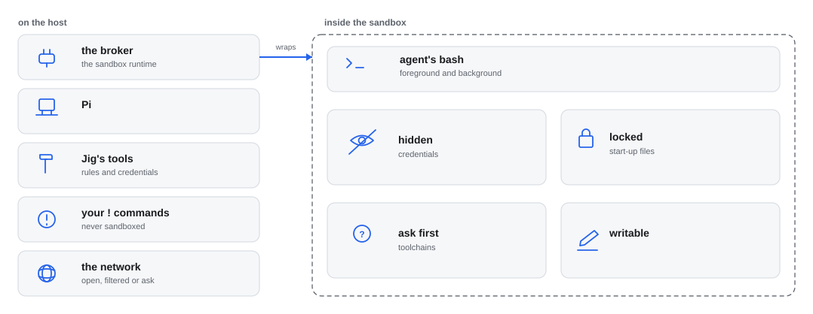

# jig-sandbox: the agent's shell, in a sandbox that stays out of the way

**Status: built.** The agent’s `bash` runs in a sandbox tested on Linux and WSL2, with the macOS side from documentation.

`jig-sandbox` runs the `bash` commands the agent sends inside an operating-system
sandbox, and keeps two promises:
- **the agent cannot read your credentials:** SSH keys, cloud and cluster logins,
  tokens, the secret files of your projects — and a command does not start with an
  environment variable that names one, or with an address that carries a password;
- **the agent cannot plant anything that runs later outside the sandbox:** in your
  shell start-up files, your `PATH`, git hooks, Pi's settings, build init scripts.

Everything else works as it does outside: builds and their caches, git, package
installs, the network, servers on `localhost`. When a command does hit a rule, it
says which rule and why, and offers a way through.

Removed values are also replaced in a command's own output when they appear exactly. That
is a backstop, not a guarantee: output that encodes a value another way is not recognised.
[The environment a command starts with](docs/rules.md#the-environment-a-command-starts-with)
says exactly which variables go.

*Where the line runs. Your own `!` commands and Jig's tools stay outside; only what the agent runs in `bash` is inside, and the hidden paths start from the list `jig-core` protects from Pi's file tools.*

## Commands

| Command | What it does |
|---|---|
| `/sandbox` | Whether bash is sandboxed, every rule and where it came from, and this session's outside runs |
| `/sandbox doctor` | Checks the requirements and runs the proof commands |
| `/sandbox allowed` | Folders and hosts you allowed; `add <folder\|host>` and `forget <folder\|host>` |
| `/sandbox off`, `/sandbox on` | Turns it off or on for this session only |
| `/ps` | The [background tasks](docs/background-tasks.md): their output as it grows, and stopping one |

## Rules

The full list is in [The rules](docs/rules.md): hidden, locked, ask-first and writable paths, and why.
The broker (`broker/broker.mjs`) is the only place the runtime runs; it is a plain-JavaScript child process.

## Configure

In `~/.pi/agent/jig.json`, under `sandbox`. [Configuration](docs/configuration.md) has every field.
## Install

Linux and WSL2: `sudo apt install bubblewrap socat ripgrep`, and `python3` (usually there
already) to carry a background task's server in `filtered` and `ask`. On Ubuntu 24.04, if the doctor
says bubblewrap cannot make a user namespace:
`sudo sysctl -w kernel.apparmor_restrict_unprivileged_userns=0`. macOS: nothing to
install, the sandbox is part of the system. Native Windows is not supported yet.

## Company part (in the company plugin)

Hosts to deny (production databases) and to allow in `ask` mode, more hidden or
locked paths, and the environment names it keeps out: through `jig-core`'s section
defaults and protected paths. The company's `env.remove` and yours add up, so a
teammate's own list extends it rather than replacing it. A deny list does nothing in the
default `open` mode, so a company that wants it applied also defaults `network.mode` to
`filtered` or `ask`; otherwise `/sandbox` warns each user.

## Later

- **Stand-in credentials:** a command gets a placeholder, and the proxy puts the real
  value back only on the way to an allowed host, so a build can reach a private
  repository without ever seeing its token.
- Native Windows.

## Layout

- `index.ts`: the entry Pi loads; it hands on to `src/index.ts`.
- `src/`: the implementation, its checks and the parts it runs on.
- `skills/`: none: the tool text is the entry.
- `test/`: the unit tests, fake hosts and real-program tests.
Every file: [Code map](docs/code-map.md).

## More detail

**Use it**
- [Network](docs/network.md): Read before you change the network.
- [Background tasks](docs/background-tasks.md): Read before you start long work.

**Set it up**
- [Configuration](docs/configuration.md): Read before you add settings.

**Trust it**
- [The rules](docs/rules.md): Read when a command is refused.
- [When a command hits a rule](docs/when-blocked.md): Read when a command is refused.

**Change it**
- [Code map](docs/code-map.md): Read before you change the code.
- [Design](docs/design.md): Read before you change the design.
