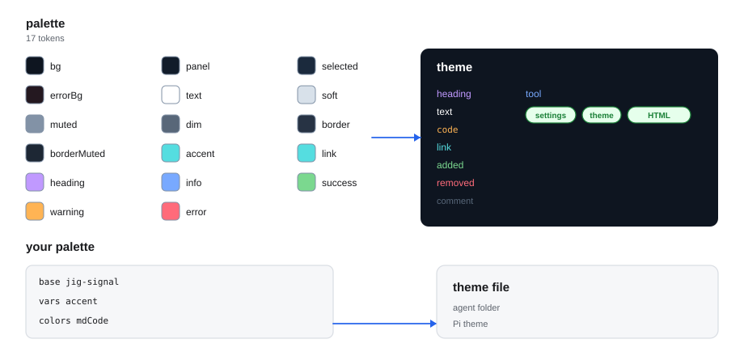

# jig-theme: palettes, a footer, and your own colours

**Status: built.** Six palettes and a footer, tested with Pi’s own validator and loader.

Not tried yet: macOS, Windows, a terminal without truecolor, and answers streaming from a
live model.

`jig-theme` changes how Pi looks, and nothing else. It brings:
- **six palettes,** shipped as ordinary Pi themes, so they appear in Pi's
  `/settings` next to `dark` and `light`;
- **your own palettes,** written in `jig.json` as a few colours over one of
  the six;
- **a one-line footer:** model, thinking level, context size, prompt-cache
  time left, cost and tokens. You choose its parts and their order, and other
  plugins can add theirs;
- **answers in the theme's text colour,** so they stand apart from thinking.

```text
Claude Opus 5.5 · high · ctx 182k · cache 3:41 · est. $4.21 · ↑12.4k ↓3.1k
```



*How a palette becomes a theme. Each palette names seventeen colours, and one role map spreads them over all of Pi's roles. Your own palette starts from a built-in one and changes only what you list.*

## Palettes and colours

Six built-in palettes, each naming seventeen colours that one role map spreads over Pi's roles; names, contrast and the
exception are in [Palettes](docs/palettes.md). Your own palette starts from one and changes only the colours you list,
in `~/.jig/jig.json` under `theme` ([Your palettes](docs/your-palettes.md)).

## The footer

The parts are `model`, `thinking`, `context`, `cache`, `cost` and `tokens`, plus optional `branch`, `cwd`, `statuses`
and other plugins' segments. Add one by emitting `jig-theme:segment` on Pi's event bus; every part, colour and limit is in
[The footer](docs/footer.md).

## Commands

| Command | What it does |
|---|---|
| `/theme` | Lists every theme Pi has, with a colour swatch each; moving shows it live |
| `/theme <name>` | Switches to that theme and keeps it, as `/settings` does |
| `/theme reload` | Reloads Pi, which reads `jig.json` again and writes your palettes |
| `/theme footer on` / `off` | Shows or hides the Jig footer for this session |

In the list, Enter keeps a theme and Esc puts back the one you had. `/theme reload` says what it wrote.

Anything else shows the usage line, `Usage: /theme [name | reload | footer on|off]`,
and does nothing. Without a terminal, `/theme` and `/theme <name>` say they need one.

## Rules

- **Pi's own themes.** Palettes are theme files in Pi's format. They work in `/settings`, in Pi's HTML export, and without the
  rest of Jig.
- **Only files it wrote.** `jig-theme` writes and deletes only theme files it wrote itself and nobody has changed since.
- **Looks only.** It reads the session and the extension statuses, and writes only theme files. It has no tools, so the model
  never sees it.
- **Never in the way.** No footer in subagent children, without a terminal, or with `JIG_THEME_FOOTER=0`. If a Pi update changes
  what the answer colour depends on, answers keep Pi's default colour.

## Configure

In `~/.jig/jig.json`, under `theme`. Every field is optional. `jig-core`
checks the section at session start; a mistake names the key, and the defaults
apply.

| Field | Default | Meaning |
|---|---|---|
| `palettes` | none | Your palettes, above |
| `footer.enabled` | `true` | `false` keeps Pi's own footer |
| `footer.segments` | `["model", "thinking", "context", "cache", "cost", "tokens", "plugins", "statuses"]` | The parts, in order |
| `footer.dropFirst` | `["tokens", "cache", "branch", "cwd", "plugins"]` | What a narrow terminal gives up first |
| `answerColor` | `"text"` | The Pi role answers are drawn in; `false` leaves Pi's default |

The footer's colours, context limits, cost decimals and separator are in
[The footer](docs/footer.md#configure).

## Company part (in the company plugin)

- a company palette, through `jig-core`'s section defaults;
- footer defaults, such as which parts to show;
- footer parts of its own, such as the month's model spend, through
  `jig-theme:segment`.

## Layout

- `index.ts`: the entry Pi loads; it hands on to `src/index.ts`.
- `src/`: the implementation, its checks and the parts it runs on.
- `skills/`: none: the tool text is the entry.
- `test/`: the unit tests, fake hosts and real-program tests.

## More detail

**Use it**
- [The footer](docs/footer.md): Read before you change the footer.

**Set it up**
- [Palettes](docs/palettes.md): Read before you change colours.
- [Your palettes](docs/your-palettes.md): Read before you add colours.
